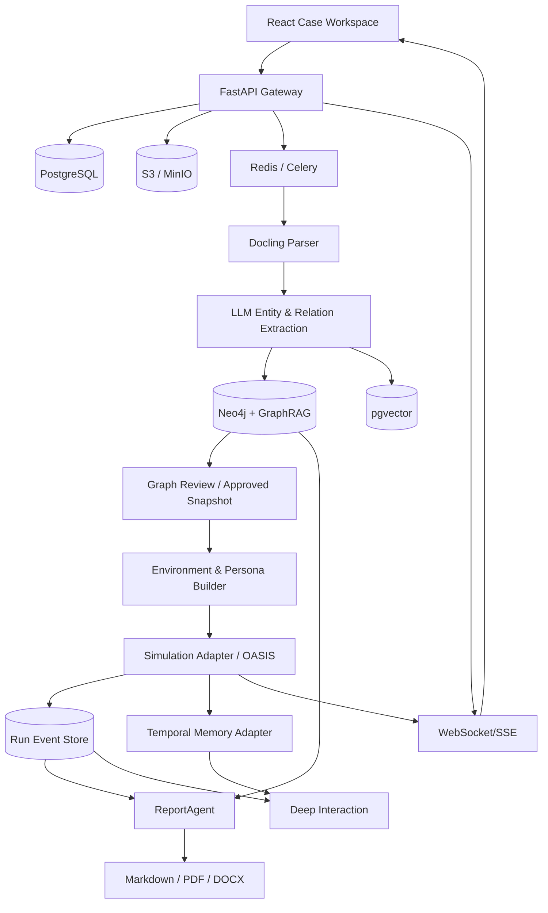

# Case Intelligence & Simulation Platform
## Complete Project Note — Case Creation, GraphRAG, MiroFish Simulation, Reporting and Deep Interaction

**Version:** 1.0 | **Date:** 31 October 2026 | **Status:** Proposed architecture / implementation blueprint

> **Purpose:** Build a case-centric, evidence-grounded simulation platform. Users upload PDF, Markdown, or plain-text documents; create and review a knowledge graph; select Person, Organization, or Country as a simulation focus; run synthetic multi-agent scenarios; generate reports; and interrogate simulated agents. Simulated outputs are hypotheses, not validated predictions.

## 1. Product overview

### 1.1 Core value proposition

- **Case Creation & Graph Build:** Convert one or multiple source documents into a traceable knowledge graph.
- **Environment Setup:** Select a person, organization, or country; configure scope, relevant actors, persona assumptions, rules, and simulation objectives.
- **Simulation:** Run repeatable, instrumented multi-agent scenarios inspired by MiroFish/OASIS.
- **Report Generation:** Analyze simulated behavior, compare scenarios, and produce citation-rich PDF/Word/Markdown reports.
- **Deep Interaction:** Ask questions of a ReportAgent and role-play conversations with synthetic agents, with explicit disclosure that responses are simulated.
- **Case Workspace:** Manage case history, uploads, graph versions, simulation runs, permissions, export and audit trails.

### 1.2 End-to-end journey

`Login → Cases → Create Case → Upload PDF/MD/TXT → Parse → Extract ontology/entities/relations → Entity resolution → GraphRAG → Graph Review → Approve Graph Snapshot → Environment Setup (Person / Organization / Country) → Generate Personas → Configure Scenarios → Run Simulation → Inspect Timeline + Graph Changes → Generate Report → Chat with Agents/ReportAgent → Compare/Rerun`

### 1.3 Important boundaries

- The **case graph** represents extracted claims about real source material, with evidence/provenance and uncertainty.
- The **simulation world** is a synthetic scenario assembled from an approved case graph and explicit assumptions.
- The **simulation activity graph** stores interactions generated by synthetic agents, not claims about the real world.
- Never silently write simulation-generated events into the approved factual knowledge graph.
- Person, Organization, and Country are **focus modes**, not interchangeable entity types. Country-mode simulations require institutions, populations, regions, and scenario rules rather than a single country-as-a-person agent.

## 2. Reference: MiroFish

**Primary reference:** https://github.com/666ghj/MiroFish  
**Console:** https://mirofish.ai/console  
**Agent simulation framework:** https://github.com/camel-ai/oasis

MiroFish's main workflow is: (1) Graph Building, (2) Environment Setup, (3) Start Simulation, (4) Report Generation, (5) Deep Interaction. The upstream project uses a Vue/Vite UI, Python/Flask APIs, Zep-powered graph/memory integration and the OASIS multi-agent social simulation engine. Consult the specific pinned upstream commit, dependency manifest, license, and runtime configuration before incorporating code; forks may use different storage components. MiroFish is AGPL-3.0; evaluate obligations with legal counsel if distributing/modifying or providing a network-hosted derivative. OASIS has its own Apache-2.0 license.

### 2.1 Reuse / adapt / build decisions

| Area | Decision | Explanation |
|---|---|---|
| OASIS simulation loop | **Reuse via adapter** | Preserve tested social-agent execution primitives while controlling profiles, seeds and telemetry. |
| MiroFish simulation preparation/persona prompts | **Study and adapt** | Use as a starting point; require typed schemas, review and explicit assumptions. |
| MiroFish graph/memory implementation | **Reference or selectively adapt** | Upstream Zep model may not fit desired Neo4j/self-hosted persistence. Use a memory abstraction. |
| MiroFish report agent | **Reference or adapt** | Add auditable tools, evidence citations, run references, uncertainty and scenario comparison. |
| Case CRUD/source/document provenance | **Build** | Case-based multi-user workspace and source review are specific product needs. |
| Interactive case graph | **Build** | Sigma.js + Graphology with richer selection, filters, edge provenance and versions. |
| Environment editor | **Build** | Person/Organization/Country-focused settings, templates, reviewable personas. |
| Simulation dashboard | **Build** | Timeline, agent actions, counterfactual runs, metrics, replay and graph deltas. |
| Reports/export/audit/RBAC | **Build** | Production workflow requirements. |

**Integration strategy:** Prefer a separate `simulation-adapter` service interfacing to a pinned MiroFish/OASIS fork or library instead of tightly merging the entire MiroFish UI, API and database into your application. Preserve license notices and compatibility tests.

## 3. User roles and security

- **Admin:** Configure authentication, models, quotas, retention, project access, environments and integrations.
- **Case Owner / Analyst:** Create cases, upload sources, build and review graphs, configure runs, produce reports.
- **Reviewer:** Approve entities, relationships, evidence and graph snapshots before simulations.
- **Viewer:** Explore approved graphs, reports and permitted simulation runs.
- **Service Worker:** Internal account for processing jobs, no interactive privileges.

Implement tenant/case boundaries, RBAC, audit trails, encryption, malware scanning of uploads, file type/size checks, rate limiting, LLM prompt-injection defenses, and PII handling. For identifiable real people, avoid claiming an agent is their authentic digital twin; make persona content synthetic and apply permission/privacy rules.

## 4. Technology stack and library selection

| Layer | Primary recommendation | Alternative / notes | Reason |
|---|---|---|---|
| Web frontend | React + TypeScript + Vite or Next.js | Vue if preserving MiroFish UI | Typed components and reusable dashboards. |
| Design system | Tailwind CSS + shadcn/ui + Radix UI | Mantine | Accessible enterprise components and custom styling. |
| Icons | Lucide React | — | Consistent icons. |
| Main network renderer | **Sigma.js + @react-sigma/core** | Cytoscape.js, Reagraph | WebGL visualization, many nodes and interactive network exploration. |
| Graph data structures | **Graphology** | NetworkX backend | Traversal, filtering, metadata and algorithms. |
| Physics layout | **graphology-layout-forceatlas2** | ELK, Cytoscape layouts | Clustered force-directed networks. |
| Environment/workflow editor | **@xyflow/react (React Flow)** | Rete.js | Editable nodes, workflow connections and simulation configurations. |
| Charts | Recharts / Apache ECharts | Nivo | Outcomes, timelines, comparisons and distributions. |
| Backend APIs | **FastAPI + Pydantic** | Flask if extending upstream directly | Validated APIs, typed schemas and WebSocket support. |
| Background jobs | Celery + Redis | Dramatiq/RQ | Durable long-running extraction/simulation/report jobs. |
| PDF/Markdown/TXT processing | **Docling** | PyMuPDF, pypdf, markdown-it-py | PDF layout/text extraction and normalized document structure. OCR only when unavoidable. |
| LLM structured extraction | **Pydantic + model structured-output interface** | Instructor | Typed ontology/entity/relation outputs with retries and validation. |
| GraphRAG pipeline | Microsoft GraphRAG patterns or custom extraction | LlamaIndex property graph | Ontology, communities, summaries and graph-aware retrieval. Pin versions; validate generated edges. |
| Graph database | **Neo4j** | Memgraph, PostgreSQL relational graph | Cypher querying and graph persistence. |
| App metadata | **PostgreSQL + SQLAlchemy + Alembic** | — | Cases, versions, permissions, jobs, reports. |
| Vector embeddings | **pgvector** | Qdrant | Retrieve chunks and persona context from relevant text. |
| Object storage | S3-compatible MinIO | AWS S3 | Original uploads and generated artifacts. |
| Agent simulation | **OASIS (CAMEL-AI)** | Custom agent-based engine | Synthetic social interactions and multi-agent execution. |
| Agent/memory layer | **Zep or Graphiti adapter** | Custom temporal memory | Persona and group memory; choose self-hosting vs managed deliberately. |
| Agent/report orchestration | LangGraph or custom typed tool loop | CAMEL tools | Bounded ReportAgent with auditable tool calls. |
| Live run transport | WebSockets / SSE | — | Streaming event updates to dashboard. |
| PDF reports | WeasyPrint | ReportLab | Structured branded reports. |
| DOCX reports | python-docx | — | Editable documents. |
| Testing | pytest, Playwright, Vitest | — | Unit, integration, E2E and UI regression. |
| Observability | OpenTelemetry + Prometheus/Grafana + Sentry | — | Trace jobs, costs, errors and latency. |
| Deployment | Docker Compose initially; Kubernetes when needed | — | Predictable self-hosted execution. |

**Avoid unnecessary duplication:** Neo4j is the graph of record; Graphology is the frontend/in-memory graph. Postgres handles application metadata. Zep/Graphiti, if used, are memory/temporal adapters and should not become an ungoverned second source of truth.

## 5. Stage 0 — Foundation and case workspace

### UI screens
1. Login / organization and project selector.
2. Case list: name, owner, modified date, workflow status, document count, graph version, last run.
3. Case detail shell: overview, sources, graph, environments, runs, reports, conversations, activity log.
4. Create/edit/archive case wizard.

### Case data fields
`id, tenant_id, title, description, research_question, scenario_goal, tags, status, owner_id, created_at, updated_at, approved_graph_version_id`

### Build tasks
1. Create PostgreSQL schema with tenant/case scope and user permissions.
2. Implement auth and audit middleware.
3. Create case CRUD and validated status transitions.
4. Add dashboard, search, filters, pagination and a responsive shell.
5. Ensure all child records are restricted to their case.

### Completion criteria
A user can create, find, update and archive a case without accessing another user's data.

## 6. Stage 1 — Case Creation & Graph Build (replaces MiroFish Graph Build)

### User experience
1. Enter title, description and target question.
2. Upload one or many PDF/MD/TXT files; show file type, size, hash and status.
3. Optionally paste plain text as a source document.
4. Select extraction scope: All / People / Organizations / Countries / Events / Policies / Locations / Topics.
5. Press **Build Graph**; show progress phases and per-file errors.
6. Open graph canvas and inspect colored nodes, typed edges, groups, community summaries and evidence.
7. Review duplicates, unsupported claims, ambiguous entities and confidence.
8. Merge/edit/reject/approve entities or edges; add manually verified nodes/edges.
9. Approve a versioned immutable graph snapshot to unlock Environment Setup.

### Detailed processing pipeline
**1. Intake:** Validate extension and MIME, check size and upload count, scan malicious files, hash, store original in MinIO and metadata in PostgreSQL. Handle scanned PDFs separately; inform user if OCR is required.

**2. Parse:** Use Docling for PDFs and appropriate Markdown/TXT loaders. Preserve headings, tables, page numbers, section paths, paragraph offsets and source IDs; annotate parser warnings.

**3. Normalize and chunk:** Normalize whitespace/encoding without destroying source offsets; chunk by semantic headings/paragraphs with controlled overlap; compute embeddings; index in pgvector. Keep exact original text spans.

**4. Generate ontology:** Create configurable allowed entity classes (Person, Organization, Country, Location, Event, Policy, Topic, Document) and relation classes (MEMBER_OF, LOCATED_IN, PUBLISHED, PARTICIPATED_IN, ANNOUNCED, AFFECTS, SUPPORTS, OPPOSES, RELATED_TO). Store relation direction and temporal qualifiers; disallow unsupported types without explicit extension.

**5. Extract claims:** Model returns strict JSON for entities and subject-predicate-object statements, with quote/span, source document and confidence/uncertainty. Never turn co-occurrence into a factual edge by default.

**6. Resolve entities:** Normalize names, aliases and transliterations; use deterministic matching plus embedding candidates; require analyst review for ambiguous merges. Preserve source-specific names and conflict history.

**7. Validate evidence:** Check quoted text exists in the cited segment, supported subject/object mentions, relation plausibility and contradictory claims. Mark status as proposed/verified/rejected, not simply 'true'.

**8. Build graph:** Write entities, relations, evidence edges, temporal validity, document lineage and case/version IDs into Neo4j; run community detection and create optional community summaries.

**9. Render:** Return nodes/edges via paginated/subgraph API to Sigma.js/Graphology; cluster with ForceAtlas2; filters and graph search; expandable neighborhoods and mini-map if needed. Load large graphs in batches.

**10. Review and publish:** Graph Review UI supports evidence drawer with direct link to source page/text, canonical-name edit, relation corrections, manual additions and approvals. Publish immutable snapshot with a manifest, content hash and approval audit.

### Graph UX specification
- Left sidebar: searchable entity and type filters, source and confidence filters, degree/importance options.
- Main canvas: smooth zoom/pan, drag nodes, community colors, typed edge styling, search-focus, layout presets.
- Right inspector: entity profile, aliases, attributes, sources, connected nodes, review controls, explanation of why an edge exists.
- Top toolbar: graph version, build status, review count, export graph JSON/CSV/SVG, fit view, layout, compare versions.
- Visual distinction: observed/source-supported vs inferred/unverified vs simulation-generated (simulation never merged into source layer).

### Suggested APIs
`POST /cases`, `POST /cases/{id}/documents`, `GET /cases/{id}/documents`, `POST /cases/{id}/graph/build`, `GET /jobs/{job_id}`, `GET /cases/{id}/graph?version=&filters=`, `GET /cases/{id}/entities/{entity_id}`, `GET /cases/{id}/evidence/{evidence_id}`, `PATCH /cases/{id}/entities/{entity_id}`, `PATCH /cases/{id}/relationships/{relation_id}`, `POST /cases/{id}/entity-merges`, `POST /cases/{id}/graph/approve`, `GET /cases/{id}/graph/versions`

### Deliverables
Parsed-source pipeline; ontology JSON schemas; versioned graph store; visual explorer; review queue; evidence traceability; approved graph snapshot.

### Acceptance tests
Upload each supported format; duplicate entity disambiguation; page-level evidence linking; reject hallucinated edges; build graph from multiple sources; compare versions; prove isolation between cases.

## 7. Stage 2 — Environment Setup

### Selection model
The user picks **one focus type**, then a focus entity or group from the approved graph:

| Focus | User configuration | Agent generation strategy |
|---|---|---|
| **Person** | Person node, relevant network, time horizon, public context, viewpoint assumptions | Synthetic focal persona plus surrounding actor groups; never assert an exact replica of a real person. |
| **Organization** | Organization node, departments/roles, partners, stakeholders, decision constraints | Role-based synthetic organizational actors and counterpart institutions. |
| **Country** | Country, sectors, regions, institutional strata, demographic cohorts, macro assumptions | Population cohorts and institutions; sample agents with explicit representativeness limits. |

### Environment wizard
1. **Choose focus:** Person / Organization / Country; select graph entity and related graph neighborhood.
2. **Scenario objective:** e.g., explore possible public responses to a policy announcement.
3. **Select actors:** include/exclude agents and groups, edit role templates; ensure diversity of perspectives.
4. **Persona builder:** derive permitted context from graph evidence, then generate synthetic persona profiles with motivations, goals, background assumptions, influence strength, social ties and uncertainty.
5. **World rules:** choose interactions allowed (post/reply/like/share/follow), network topology, moderation rules and event schedule.
6. **Channels:** simulated X-like and Reddit-like environments (not actual account control); optionally custom channels.
7. **Timing:** simulation clock, rounds, duration, time step, number of agents, concurrency, token budget.
8. **Interventions:** public or organizational events; enable controlled A/B scenario branches with changed assumptions.
9. **Quality checks:** orphan agents, unsupported persona claims, overrepresentation, privacy risks, budget limits.
10. **Approve environment:** immutable configuration snapshot with reproducible seed, model/provider and graph version.

### Persona schema
`agent_id, environment_id, synthetic_name, actor_type, graph_entity_refs[], group_id, attributes, objectives[], beliefs[], constraints[], network_links[], initial_memory_refs[], evidence_refs[], assumptions[], disclosure_label, generation_model, review_status`

### Recommended components
React Flow for editable actor/relationship/environment connections, Sigma.js for inspecting the chosen subgraph, Pydantic typed persona output, graph retrieval service, and OASIS profile adapter.

### Acceptance tests
Every focus type works; actors have evidence and assumption labels; approved environment references approved graph version; scenarios are reproducible from saved seeds/config.

## 8. Stage 3 — Start Simulation

### Engine integration
Create an adapter boundary:

`Simulation API → Run Manager → Scenario Compiler → OASIS Adapter → Agent Actions / Platform State → Event Stream → Event Store → Metrics + Temporal Memory Updates`

Study MiroFish's `simulation_runner` and OASIS scripts, then port only compatible functionality into a pinned simulation-worker image. Do not assume the original fork's runtime can be safely embedded in an API worker process; isolate CPU/memory/LLM budgets and handle subprocess failures.

### Detailed run sequence
1. Validate approved graph and environment snapshot.
2. Estimate cost: agent count × rounds × expected model calls; require consent for expensive runs.
3. Create `simulation_run` with model version, graph version, environment version, pseudorandom seed, start state and scenario assumptions.
4. Materialize synthetic agents and their initial memories.
5. Instantiate simulated social environments (X-like and Reddit-like), load action schemas and moderation/event rules.
6. Start OASIS simulation loops; parallelize platform execution where supported but record deterministic boundaries.
7. Capture each synthetic event with `run_id, tick, agent_id, platform, action, targets, content, causal_parent, memory_update_refs, timestamp`.
8. Stream deltas over WebSocket or SSE; batch UI updates to protect browser performance.
9. Update individual/group memory with timestamps, source/run attribution and retention policy.
10. Collect metrics: activity counts, graph changes, community shifts, topic prevalence, response distribution, polarization proxies and model costs.
11. Allow pause/cancel/retry. Only promise resume-from-checkpoint after it has been implemented and tested; upstream MiroFish may have limitations.
12. Seal the run output, index the event log and generate a replayable immutable summary.

### Simulation UI
- Run header: status, progress rounds, total agents, costs and health.
- Live simulated social feeds with source labels.
- Dynamic graph highlights for synthetic interactions and group activity.
- Timeline scrubber and replay controls with checkpoints.
- Metrics panels and event drill-down.
- Agent monitor: current state, actions, memory updates, failures.
- Compare runs: different rules, seeds, populations and intervention settings.
- Separate tabs for actual source graph vs simulated interaction graph.

### Critical controls
- Simulations are exploratory; never label outputs as ground truth or guaranteed forecasts.
- Do not automate posting to real accounts from the simulation module.
- Track biases, hallucinated persona assumptions, data leakage, model drift and sensitivity to seeds.
- Limit individual targeting; use synthetic or aggregate actors when personal profiling is not justified.

## 9. Stage 4 — Report Generation

### ReportAgent workflow
1. User selects completed run(s), report type and question.
2. ReportAgent queries bounded tools: case evidence lookup, graph neighborhood, timeline events, metric aggregations, community comparisons, agent-state summaries and cross-run deltas.
3. Generate report outline, extract references, compute numeric metrics using code/queries rather than free-form guesses.
4. Draft narrative sections with model-generated conclusions clearly separated from observed source facts and simulated data.
5. Validate citations and numbers; run a reviewer approval step.
6. Export Markdown, PDF and DOCX; store versions in object storage with audit records.

### Report types
- Executive overview / scenario summary.
- Network and actor analysis.
- Agent and community interaction review.
- Temporal change / emerging themes.
- Counterfactual scenario comparison.
- Assumptions, limitations, confidence and sensitivity analysis.

### Recommended report structure
Title, case and scenario metadata, executive summary, source context, modeling assumptions, agent population, experiment setup, simulated timeline, behavioral outcomes, key communities, alternative interpretations, sensitivity/validation, limitations, appendix with sources and technical manifest.

### Libraries
LangGraph or a typed custom ReportAgent orchestration layer, Pydantic schemas, SQL/Neo4j query tools, Recharts/ECharts for embedded plots, WeasyPrint for PDF, python-docx for DOCX.

### Acceptance tests
Every source assertion links to actual evidence; every simulation assertion links to run/event IDs; metrics match event store; report exports render; reports always identify synthetic nature and limitations.

## 10. Stage 5 — Deep Interaction

### Two conversation modes
- **Talk to ReportAgent:** Ask for interpretations, caveats, cross-run comparisons, metric explanations, evidence and report sections.
- **Talk to Synthetic Agent:** Choose an agent from the simulated world and ask about its simulated motives, choices and experience, limited to its persona and recorded memory.

### Technical flow
`Chat UI → conversation session → authorization → target selection → retrieve approved graph facts / synthetic agent memory / run events → bounded prompt/tool execution → response with source/run references → persist chat history`

### Required UX and safeguards
- Clearly label synthetic agent chats and avoid impersonation claims.
- Show selected agent, scenario, run ID and simulation time.
- Make 'answer from evidence' vs 'interpretation' visible.
- Let users inspect supporting source excerpts and run events.
- Prevent cross-case retrieval and hidden system instruction leakage.
- Add token budgets, redaction, refusal for unauthorized sensitive data and full audit logs.

### Acceptance tests
ReportAgent answers grounded questions with working links; agent chat is restricted to its world context; switching run changes available memory; prompt injection in source documents cannot override agent tool permissions.

## 11. Data model

### PostgreSQL tables
- `users`, `organizations`, `memberships`, `roles`, `permissions`
- `cases`, `case_members`, `case_documents`, `document_chunks`, `processing_jobs`
- `graph_versions`, `graph_reviews`, `review_actions`, `ontology_versions`
- `environments`, `environment_versions`, `personas`, `simulation_runs`, `simulation_events`, `run_metrics`, `run_checkpoints`
- `reports`, `report_versions`, `conversations`, `chat_messages`, `audit_events`, `model_usage`

### Neo4j node labels (suggested)
`CaseEntity`, `Person`, `Organization`, `Country`, `Location`, `Event`, `Policy`, `Topic`, `Document`, `Evidence`, `Community`.

### Relations (suggested)
`MENTIONS`, `SUPPORTED_BY`, `MEMBER_OF`, `LOCATED_IN`, `AFFILIATED_WITH`, `PARTICIPATED_IN`, `ANNOUNCED`, `AFFECTS`, `SUPPORTS`, `OPPOSES`, `RELATED_TO`, and only other ontologically validated types. Capture `case_id`, `version_id`, `confidence`, `valid_from/to`, `evidence_ids`, `review_status`.

### Versioning rules
- Source document original bytes are immutable; updated document becomes a new version.
- Graph versions are snapshots; approved version is immutable.
- Environment version points to one approved graph version.
- Simulation run points to one frozen environment version, graph version and model config.
- Report version points to exact simulation run IDs; chat sessions are scoped to same.
- Provenance survives graph deduplication and merge actions.

## 12. Service architecture



### Suggested repository layout

```text
platform/
  apps/
    web/                      # React/TypeScript, case UI, Sigma and React Flow
    api/                      # FastAPI routes, auth, validation
  services/
    ingestion-worker/         # Docling, extraction, entity resolution
    graph-service/            # Graph queries, provenance, versions, review
    environment-service/      # Persona and scenario compiler
    simulation-worker/        # MiroFish/OASIS adapter, event log, memory
    report-worker/            # ReportAgent and export
    chat-service/             # ReportAgent/agent interviews
  packages/
    schemas/                  # Shared JSON schemas and Pydantic models
    ui/                       # Reusable UI components
    prompts/                  # Versioned prompts and evaluations
  infra/
    docker-compose.yml
    monitoring/
    migrations/
  tests/
    fixtures/
    e2e/
    integration/
```

## 13. API outline

### Case/source/graph
- `POST /api/cases`, `GET /api/cases`, `GET/PATCH /api/cases/{id}`
- `POST /api/cases/{id}/documents`, `GET /api/cases/{id}/documents`
- `POST /api/cases/{id}/graph/build`, `GET /api/jobs/{job_id}`
- `GET /api/cases/{id}/graph`, `GET /api/cases/{id}/evidence/{evidence_id}`
- `PATCH /api/cases/{id}/entities/{entity_id}`, `PATCH /api/cases/{id}/relationships/{relationship_id}`
- `POST /api/cases/{id}/graph/approve`, `GET /api/cases/{id}/graph/versions`

### Environment
- `POST /api/cases/{id}/environments`, `GET /api/cases/{id}/environments`
- `POST /api/environments/{id}/personas/generate`, `PATCH /api/environments/{id}`
- `POST /api/environments/{id}/validate`, `POST /api/environments/{id}/approve`

### Simulations
- `POST /api/environments/{id}/runs`, `GET /api/runs/{run_id}`
- `POST /api/runs/{run_id}/cancel`, `POST /api/runs/{run_id}/pause` (if supported)
- `GET /api/runs/{run_id}/events`, `GET /api/runs/{run_id}/metrics`
- `GET /api/runs/{run_id}/agents`, `GET /api/runs/{run_id}/graph-deltas`
- `GET /api/runs/{run_id}/stream` (SSE or a dedicated WebSocket)

### Reports/chat
- `POST /api/runs/{run_id}/reports`, `GET /api/reports/{report_id}`
- `GET /api/reports/{report_id}/export?format=pdf|docx|md`
- `POST /api/conversations`, `POST /api/conversations/{id}/messages`

## 14. Frontend navigation and design principles

**Main sidebar:** Dashboard, Cases, Create Case, Graph Explorer, Environments, Simulations, Reports, Conversations, Admin.

**Per-case navigation:** Overview | Sources | Graph | Review | Environments | Runs | Reports | Chat | Audit.

**Visual style:** restrained dark-on-light or dark intelligence workspace; blue for Person, violet for Organization, amber for Country; clearly separate verified/source claims, suggested/uncertain relations and synthetic simulation events. Avoid excessive glowing nodes and animation. Use semantic color plus text and shape, keyboard shortcuts, WCAG contrast, accessible controls and progressive rendering.

**Graph interactions:** click node, focus neighborhood, drag/pin, search, typed filters, community isolate, multi-select, inspect edge and exact evidence, compare versions, export, controlled layout reset. Do not load a 100k-edge graph fully into React DOM; render WebGL and paginate graph queries.

**Simulation interactions:** play/pause/replay only where engine supports it; step through a saved timeline; select agent; inspect causal event chain; show platform activity and uncertainty, scenario variants and run comparison.

## 15. Delivery roadmap (recommended order)

### Phase A — Foundation
Case CRUD, user roles, upload storage, Postgres schema, auth, audit and basic UI shell.

### Phase B — Evidence graph MVP
Document parsing, typed extraction, entity resolution, Neo4j, Graphology/Sigma viewer, provenance drawer, review and approved snapshots.

### Phase C — Environment MVP
Three focus modes, persona schemas, editable assumptions, initial social graph, scenario setup and validation.

### Phase D — Simulation MVP
OASIS adapter, single controlled scenario, synthetic feed, event capture, progress/status, saved run summaries; add parallel social platforms after stable integration.

### Phase E — Analytics/reporting
Metrics aggregation, run comparison, ReportAgent tools, structured templates and export.

### Phase F — Deep Interaction and hardening
Synthetic-agent chat, report chat, memory retrieval, permissions, model evaluation, load tests and production security.

## 16. Work breakdown by team

**Frontend:** case dashboard, upload workflow, graph UI, environment editor, simulation dashboard, report viewer, chat.

**Backend:** auth/RBAC, case/documents API, orchestration queue, graph APIs, versions, run API, report/chat APIs.

**AI/knowledge:** parsing, ontology, entity/relation extraction, resolution, evidence verifier, persona generator, evaluation datasets.

**Simulation:** MiroFish/OASIS source study, adapter, model providers, event schema, temporal memory, checkpoints, telemetry and scenario comparisons.

**DevOps/QA:** container orchestration, secrets, budgets, logs, tracing, backups, security scanning, e2e, integration and model quality evaluation.

## 17. Validation and quality metrics

- **Document extraction:** parse success rate; page/span provenance completeness.
- **Graph quality:** entity precision/recall against annotated cases; relation precision; duplicate resolution error; evidence link validity.
- **Review:** approval turnaround; % relationships reviewed; change log traceability.
- **Simulation:** runs completed, events captured, agents with coherent state, run failures, average model cost, reproducibility across controlled seeds.
- **Reports:** factual citation accuracy, computed-metric consistency, export formatting and reviewer acceptance.
- **Usability:** graph interaction latency, browser performance under large networks, task completion time and accessibility testing.
- **Security:** tenant isolation, upload validation, prompt-injection resilience, secrets handling and complete audit.

Use historical or holdout cases to calibrate scenario outputs. Do not represent raw LLM-based scenario probabilities as empirical predictive accuracy.

## 18. Risks and decisions requiring early resolution

1. **Licensing:** MiroFish AGPL-3.0 vs OASIS Apache-2.0; determine whether to fork, integrate through a service, or independently implement components.
2. **Memory backend:** Zep Cloud vs Graphiti + Neo4j; benchmark operational costs and compatibility before committing.
3. **Model selection:** latency, output schema adherence, token budgets, supported languages, data residency and quality on local names/aliases.
4. **Simulation scale:** number of agents and turns; start with a bounded cohort and record actual costs before scaling.
5. **Causal validity:** agent-generated outcomes are exploratory, not reliable real-world predictions without external validation.
6. **Entity privacy:** distinguish public roles from protected personal data; restrict sensitive person-level modeling.
7. **Country realism:** stratify synthetic actors and acknowledge representation, sampling and modeling limitations.
8. **Long jobs:** support cancellation, retries, error states, idempotency and eventually real checkpoint/resume.
9. **Graph provenance:** prioritize source evidence over aesthetically dense but unsupported graphs.

## 19. MVP definition of done

1. Create a case and upload PDF/MD/TXT with file progress.
2. Build a source-linked graph of persons, organizations, countries, events and relationships.
3. Review/edit/merge/reject graph claims and approve a snapshot.
4. Pick Person, Organization or Country and configure an environment from that snapshot.
5. Run a small OASIS-based synthetic social scenario with durable event logs.
6. Explore synthetic posts, agent interactions, graph evolution and run metrics.
7. Produce a downloadable report showing evidence and simulation limitations.
8. Chat with ReportAgent and one simulated agent from a selected run.
9. Enforce RBAC/case isolation, audit changes and recover gracefully from failed jobs.

## 20. Key official/reference links

- MiroFish upstream: https://github.com/666ghj/MiroFish
- MiroFish console: https://mirofish.ai/console
- OASIS (CAMEL-AI): https://github.com/camel-ai/oasis
- Sigma.js: https://www.sigmajs.org/
- Graphology: https://graphology.github.io/
- React Flow: https://reactflow.dev/
- Cytoscape.js: https://js.cytoscape.org/
- Docling: https://docling-project.github.io/docling/
- Microsoft GraphRAG: https://github.com/microsoft/graphrag
- Neo4j: https://neo4j.com/
- pgvector: https://github.com/pgvector/pgvector
- FastAPI: https://fastapi.tiangolo.com/
- LangGraph: https://github.com/langchain-ai/langgraph

---

**Implementation recommendation:** Start with the case + evidence graph as the stable system of record, then add environment selection and an isolated OASIS adapter. This prevents simulation-generated claims from contaminating source evidence while providing the complete MiroFish-inspired user journey.
