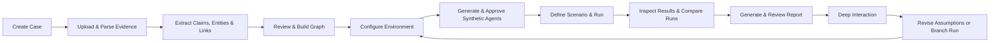
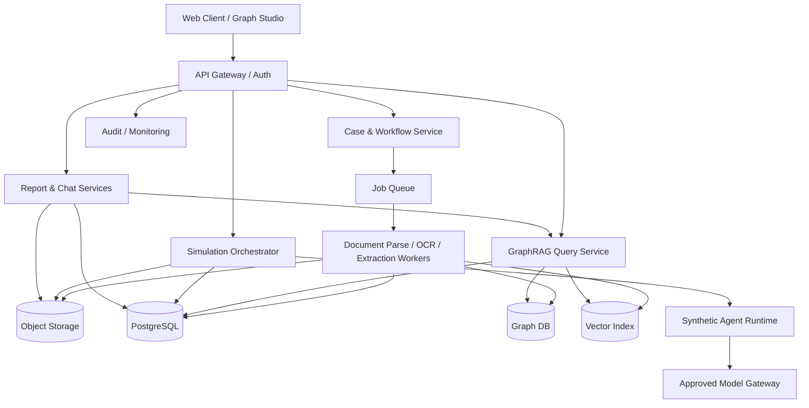
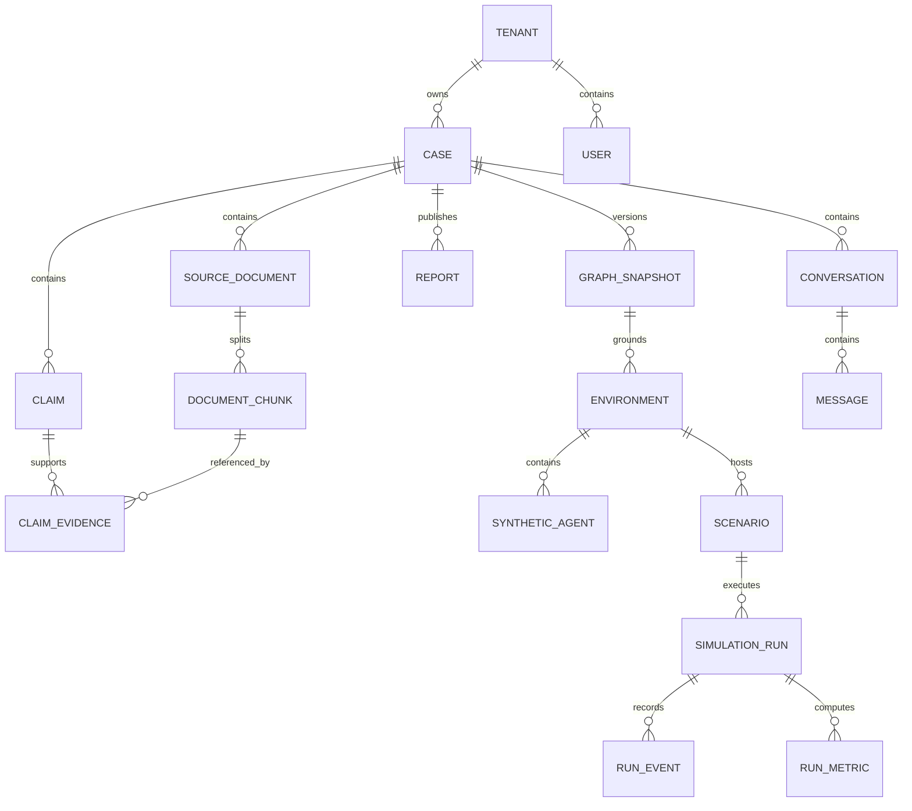

# M2 Swarm — Case Intelligence, Knowledge Graph & Multi-Agent Simulation Platform
## Software Requirements Specification (SRS)

| Document metadata | Value |
|---|---|
| Document ID | M2-SWARM-SRS-002 |
| Version | 2.0 — Detailed Draft |
| Date | 31 October 2026 |
| Owner | CtrlAlt — M2 Swarm Product Team |
| Status | Draft for stakeholder validation; not approved baseline |
| Classification | Internal / Confidential (proposed; confirm with product owner) |
| Reference | Existing M2 Swarm SRS v1.0 and MiroFish-inspired five-stage workflow |

> **Design principle:** M2 Swarm is an evidence-grounded *scenario exploration and simulation* platform, not an oracle for predicting real human behavior. The system must explicitly distinguish source facts, analyst judgments, model inferences, synthetic personas, and simulated outputs. It must not silently convert simulations into claims about actual people, organizations, or countries.

## Document control

| Version | Date | Change | Status |
|---|---|---|---|
| 1.0 | 31 Oct 2026 | Initial baseline | Reference |
| 2.0 | 31 Oct 2026 | Detailed workflow, requirements, use cases, architecture, data model, NFRs, test criteria | Draft |

**Approval fields:** Product Owner: TBD; Technical Lead: TBD; Security Reviewer: TBD; Client/Business Approver: TBD.

---

# 1. Introduction

## 1.1 Purpose
This SRS establishes testable functional, data, security, UX, integration and operational requirements for M2 Swarm. It is intended for product owners, business analysts, designers, developers, AI/ML engineers, QA, DevOps and project reviewers. It describes *what* the platform shall do, with architecture and library suggestions explicitly treated as implementation proposals rather than unapproved contractual commitments.

## 1.2 Product vision
M2 Swarm enables analysts to create a case from documentary evidence; extract entities, events and relationships; build and explore a provenance-aware knowledge graph; configure a bounded synthetic environment around a person, organization or country; launch reproducible multi-agent simulations; inspect timelines and interactions; generate evidence-linked reports; and ask questions of synthetic agents or a reporting assistant.

## 1.3 Goals and measurable outcomes
1. Create traceable cases with preserved source files and source lineage.
2. Reduce manual time to prepare an initial entity graph while preserving analyst review.
3. Offer useful person-, organization- and country-scoped environment templates.
4. Execute bounded simulations with explicit assumptions, seeds, versions and logs.
5. Produce reviewable findings with confidence qualifiers and evidence references.
6. Give analysts an interactive and legible graph and simulation workspace.
7. Apply strict access control, auditability, data minimization and misuse safeguards.

**Proposed initial success targets (validate during planning):** source-to-graph processing success ≥95% for supported, valid text-based files; graph navigation interactive at 2,000 visible nodes using progressive rendering; report generation creates a saved version and supports Markdown/PDF/Word; 100% of published findings distinguish evidence from simulation; 100% of case mutations have an audit event.

## 1.4 Scope
**In scope:** case lifecycle; PDF/MD/TXT intake; extraction and chunking; NER/entity resolution; knowledge graphs; GraphRAG retrieval; graph editing and validation; person/organization/country environment templates; synthetic agent/persona design; scenario and experiment definitions; simulation runs and branches; visual timelines and dual-channel synthetic discourse; report generation; deep interaction; dashboards; identity and access management; observability and export.

**Out of scope for v2 baseline unless separately approved:** automatic truth determination; real-world influence or account-control operations; impersonating actual people; automated engagement or posting to real social media; harvesting private personal information; uncontrolled web scraping; covert profiling of sensitive traits; operational advice for manipulating individuals or political groups; integration with other CtrlAlt products by default. M2 Swarm remains a distinct product unless a separate integration specification authorizes an interface.

## 1.5 Terminology
| Term | Definition |
|---|---|
| Case | Bounded workspace of sources, graph, assumptions, configurations, runs, interactions and reports. |
| Reality seed | Evidence inputs from uploaded sources and explicitly supplied assumptions; not a guarantee of objective reality. |
| Entity | Person, organization, country, place, event, topic, document or other typed node. |
| Edge | A directed, typed relationship with temporal and source attributes. |
| Claim | Atomic proposition extracted or entered with provenance and verification status. |
| GraphRAG | Retrieval technique combining graph traversal and text/vector retrieval for grounded answers. |
| Environment | Snapshot of entities, agents, roles, rules, topics and initial state for a run. |
| Synthetic agent | Simulated participant following a versioned persona and bounded decision rules. |
| Simulation run | Versioned execution of a scenario against an environment snapshot. |
| ReportAgent | Assistant that queries approved run artifacts and cites their provenance. |
| Deep interaction | Analyst conversations with synthetic agents or ReportAgent, always labeled simulated. |
| Dual-channel | Two configurable, **synthetic** interaction spaces within a simulation, not live external posting. |
| Confidence | Calibrated or qualitative uncertainty label; not automatically a real probability. |

## 1.6 Assumptions and constraints
- Supported documents initially are PDF, Markdown and plain text. Scanned PDFs and OCR require a separately enabled OCR pipeline and quality checks.
- Entities are often ambiguous, multilingual or conflicting; analyst adjudication is necessary.
- Country-level environments are *abstractions*, not comprehensive accurate replicas of national populations.
- Persona outputs are synthetic constructs and must not be presented as factual psychological assessments of identified individuals.
- All model providers and external integrations require approval and documented data-handling rules.
- Time, cost and concurrency targets remain provisional until load tests and infrastructure sizing.

# 2. Stakeholders, actors and permissions

| Actor | Responsibilities | Typical permissions |
|---|---|---|
| Platform Super Admin | Tenant config, user governance, quotas, provider settings | System-wide administrative functions; audited break-glass access |
| Organization Admin | Team/workspace membership, policy, templates | Administer assigned tenant |
| Case Owner | Scope, case lifecycle, approvals | Full assigned-case edit, sharing, archive |
| Analyst / Researcher | Source review, graph construction, experiments, reports | Assigned-case create/read/edit/run |
| Reviewer / Approver | Verify graph, assumptions, reports, releases | Review and approve; cannot overwrite approved history |
| Viewer | Inspect published/authorized artifacts | Read-only |
| Service Worker | Async processing and simulation orchestration | Least-privilege service-scoped operations |
| Synthetic Agent | Respond inside a simulation | No external account access or autonomous platform administration |

**Permission model:** RBAC with case-scoped grants, optionally extended with attributes (classification, tenant, expiry, source sensitivity). A user can hold different roles on different cases. Denied actions fail closed and are logged without leaking protected content.

# 3. End-to-end workflow and lifecycle



**Case status:** `draft → ingesting → graph_review → graph_ready → environment_setup → ready_to_run → running → completed → report_review → published → archived`. Error and paused states are orthogonal; users cannot move to `graph_ready`, `ready_to_run` or `published` without relevant quality/approval gates. Each stage stores its input/output snapshot and actor identity.

**Stage mappings:** (1) Case Creation & Graph Build → (2) Environment Setup → (3) Simulation → (4) Reporting → (5) Deep Interaction. After stage 5, revisions create branches or newer versions rather than mutate prior completed runs.

# 4. Functional requirements — common conventions

Every requirement has a unique ID. Priority: **M** mandatory for first accepted release, **S** should-have, **C** could-have. Validation: UI, API, integration, automated test or review. Requirements that need policy signoff are marked **[DECISION]**. Unless explicitly stated otherwise, all time values are stored in UTC with user-local rendering, all records belong to a tenant and case, and all material edits are audit logged.

## 4.1 Case creation and lifecycle

| ID | Priority | System shall... | Acceptance verification |
|---|---|---|---|
| CASE-001 | M | Create a case with title, description, objective, primary scope type (`person`, `organization`, `country`), visibility and owner. | Required-field and persistence tests. |
| CASE-002 | M | Generate immutable case ID and maintain versioned metadata. | ID uniqueness/version checks. |
| CASE-003 | M | Support draft autosave and explicit Create/Save actions. | Reload without data loss. |
| CASE-004 | M | Permit scope-specific optional fields (time period, geography, domain, focal entity, questions). | Dynamic forms and API schema validation. |
| CASE-005 | M | Show stage progress, activity stream and readiness blockers. | Status reflects actual gates. |
| CASE-006 | M | List, search, sort and filter cases by owner, status, type, date and tags. | Filter accuracy tests. |
| CASE-007 | M | Allow authorized team sharing with case-level permissions. | Unauthorized access denial. |
| CASE-008 | M | Archive/restore; destructive deletion only under approved retention policy. | State/retention audit test. |
| CASE-009 | S | Duplicate a case as a new case with selectable evidence/configuration, preserving provenance. | New IDs, inherited lineage. |
| CASE-010 | M | Capture an explicit research question and output expectations before build. | Cannot mark setup ready without question. |
| CASE-011 | S | Offer case templates for person, organization and country without prescribing ground truth. | Template creation test. |
| CASE-012 | M | Prevent cross-tenant case references and enforce least privilege throughout. | Negative authorization tests. |

### 4.1.1 Case form details
**Shared:** title (3–160 characters), short description (≤1,500), objective (≤3,000), research questions (1–10), period start/end, tags, classification, language, owner and collaborators. **Person case:** focal public/hypothetical entity, role/context, research boundary; no covert sensitive-attribute inference. **Organization case:** organization identity, sector, geography, stakeholders, known public relationships. **Country case:** country, relevant regions, time horizon, institutions and scenario themes; country templates are approximations with explicit coverage limitations. User may switch scope type before run; changing type invalidates incompatible environment configuration until reviewed.

## 4.2 Source intake, document processing and knowledge extraction

| ID | Priority | System shall... | Acceptance verification |
|---|---|---|---|
| ING-001 | M | Upload PDF, MD, TXT as single or multi-file attachments within approved size limits. | Type and size test. |
| ING-002 | M | Run server-side MIME validation, malware scanning and checksum deduplication. | Reject disguised/unsafe files. |
| ING-003 | M | Preserve original file, checksum, page/section structure and upload actor. | Download and checksum match. |
| ING-004 | M | Extract text and retain page offsets/anchors for citations. | Citation maps to source passage. |
| ING-005 | M | Report parse status, errors and extraction quality; permit retry. | Invalid input produces actionable error. |
| ING-006 | S | Support optional OCR for scanned PDFs with per-page confidence. | Scanned test fixtures. |
| ING-007 | M | Detect document language and preserve original-language text. | Multilingual fixture checks. |
| ING-008 | M | Chunk content reproducibly, with chunk version, offsets and token counts. | Same config gives same boundaries. |
| ING-009 | M | Extract candidate entities, events, dates, claims and relationship triples. | Schema and source-link test. |
| ING-010 | M | Store extraction model/prompt/version and confidence/uncertainty metadata. | Audit record visible. |
| ING-011 | M | Distinguish quoted evidence from model-generated summary or interpretation. | Output labels and citations. |
| ING-012 | M | Identify candidate duplicate/alias entities for analyst merge or split. | No silent irreversible merge. |
| ING-013 | M | Permit edit/reject/approve of each extracted fact and relationship. | Review trail maintained. |
| ING-014 | M | Handle contradictory sources as separate claims with attribution rather than overwrite. | Conflict fixtures. |
| ING-015 | S | Batch reprocess selected documents using upgraded extraction versions. | Prior results remain available. |
| ING-016 | M | Treat uploaded instructions as untrusted text and isolate them from system instructions. | Prompt-injection tests. |
| ING-017 | S | Identify source dates, publication date vs event date and date uncertainty. | Date provenance test. |
| ING-018 | M | Allow user to remove source from active graph and indicate derived objects affected. | Lineage and impact display. |

**Processing pipeline:** upload → validate → immutable storage → PDF/MD/TXT parse → optional OCR → normalize → language detection → split/chunk → entity/claim/event extraction → linking/dedup candidate generation → provenance capture → graph staging → analyst review → approved graph snapshot. Extraction jobs must be idempotent and retryable.

## 4.3 Graph Build and interactive GraphRAG

| ID | Priority | System shall... | Acceptance verification |
|---|---|---|---|
| GR-001 | M | Maintain a typed property graph with nodes, edges, attributes, source lineage and revisions. | Data integrity tests. |
| GR-002 | M | Offer interactive pan, zoom, select, hover, search and fit-to-view. | UI interaction tests. |
| GR-003 | M | Color/shape nodes by type and show an accessible legend. | Visual and accessibility review. |
| GR-004 | M | Support graph filters by entity type, edge type, confidence, date, source and approval state. | Filter results verified. |
| GR-005 | M | Open entity detail panel: aliases, descriptions, evidence, connected nodes, status, history. | Evidence traceability. |
| GR-006 | M | Open edge detail panel: relationship, direction, timing, sources and reviewer decision. | Provenance cross-link. |
| GR-007 | M | Add/edit/remove nodes and edges with validation and change reason. | History and conflict test. |
| GR-008 | M | Offer approve/reject/merge/split workflows and record curator identity. | Review audit. |
| GR-009 | M | Compute neighborhood/path/subgraph queries over permitted nodes only. | Traversal and ACL tests. |
| GR-010 | M | Provide hybrid text/vector/graph retrieval and show supporting citations. | Grounded answer benchmark. |
| GR-011 | M | Mark edges as `observed`, `reported`, `inferred`, `hypothetical` or `simulated`. | Legend and data schema tests. |
| GR-012 | M | Save named graph snapshots; a simulation references an immutable approved snapshot. | Snapshot reproducibility. |
| GR-013 | S | Support timeline view and time-sliced edges/events. | Temporal fixture tests. |
| GR-014 | S | Support community clustering and centrality metrics with method labels. | Calculated metric comparisons. |
| GR-015 | S | Export filtered graph to JSON/CSV and a static PNG/SVG view, subject to permissions. | Export contents and data masking. |
| GR-016 | M | Show graph coverage and extraction issues, including orphan nodes, contradictory claims and missing sources. | Quality panel flags fixtures. |
| GR-017 | M | Render large graphs progressively via aggregation and level-of-detail rather than block the browser. | Performance benchmark. |
| GR-018 | S | Support a side-by-side comparison of graph snapshot versions. | Change-set accuracy. |

### 4.3.1 Graph schema
**Node types:** Person, Organization, Country, Region, Location, Event, Topic, Claim, Document, Source, Role, Community, ScenarioVariable. **Edge types (examples):** MEMBER_OF, WORKS_FOR, LOCATED_IN, PARTICIPATED_IN, MENTIONED_IN, REPORTED_BY, SUPPORTS, CONTRADICTS, RELATES_TO, INFLUENCES_HYPOTHETICALLY, OCCURRED_AT, HAS_ROLE. All relationship direction and semantics must be defined in a schema registry; `INFLUENCES_HYPOTHETICALLY` may only be used for explicitly simulated or analyst-hypothesized relationships.

**Node minimum fields:** `id`, `tenant_id`, `case_id`, `node_type`, `display_name`, `aliases[]`, `description`, `status`, `created_at`, `updated_at`, `revision`, `visibility`. **Edge minimum fields:** `id`, `source_node_id`, `target_node_id`, `edge_type`, `statement`, `evidence_ids[]`, `certainty_label`, `epistemic_status`, `valid_from`, `valid_to`, `review_status`, `revision`. **Evidence link:** source ID, file checksum, page/section/offset, quote span, extraction run, reviewer and any counterevidence.

### 4.3.2 Graph workspace layout
Left rail: case navigator, data sources, entity types, filters. Center: resizable graph canvas with layout switch (force-directed, hierarchical, timeline, radial where appropriate), minimap and zoom controls. Right drawer: node/edge information, original evidence excerpts, editable properties and review actions. Header: build progress, graph version, sync status, save snapshot and next-stage readiness. Bottom drawer: extraction issues, conflicts, job activity and system messages. No source, inferred or simulated edges share identical styling without a visible label.

## 4.4 Environment setup: Person / Organization / Country

| ID | Priority | System shall... | Acceptance verification |
|---|---|---|---|
| ENV-001 | M | Let the analyst select one scope: person, organization or country, or inherit from case. | Scope switch tested. |
| ENV-002 | M | Propose environment entities and roles from the approved graph, clearly labeled as suggestions. | Proposed vs approved distinction. |
| ENV-003 | M | Provide scope-specific environment setup forms and defaults. | Templates show correct fields. |
| ENV-004 | M | Require objective, time horizon, baseline assumptions and scenario constraints. | Readiness validation. |
| ENV-005 | M | Select graph snapshot, included entities and excluded entities. | Membership verified. |
| ENV-006 | M | Set participant/agent count, composition and simulation channel configuration. | Config validation and limits. |
| ENV-007 | M | Generate editable synthetic persona cards from allowed graph context and analyst inputs. | Persona grounding and labels. |
| ENV-008 | M | Maintain persona memory as versioned synthetic state isolated per run. | Isolation tests. |
| ENV-009 | M | Set agent goals, role, knowledge boundaries, decision constraints and permitted actions. | Policy enforcement tests. |
| ENV-010 | M | Review/approve environment and persona package before simulation. | Approval gate test. |
| ENV-011 | M | Detect missing fields, conflicting assumptions and graph changes affecting readiness. | Validation output. |
| ENV-012 | S | Offer persona distribution overview and demographic representativeness warnings where relevant. | Coverage warning displayed. |
| ENV-013 | M | Prevent importing private or sensitive inferred traits as verified persona facts. | Safety and data classification tests. |
| ENV-014 | M | Version environment configurations; running uses immutable snapshot. | Version linkage test. |
| ENV-015 | S | Permit named environment templates and branch creation. | Clone/branch works. |

### 4.4.1 Person scope
Intended for a bounded role or hypothetical individual scenario, not covert private-person modeling. Fields: focal subject label, permitted public/supplied context, role, known statements, relationships, initial goals, explicit uncertainties, constraints, response style, triggers, simulated social setting. Where a real individual is referenced, the platform must not claim to reconstruct their private mental state or infer sensitive protected traits.

### 4.4.2 Organization scope
Fields: organization profile, teams/units, roles, formal reporting lines, stakeholder map, operational priorities, resources and constraints, communication norms, decision thresholds, event triggers and external relationships. Outputs should label any modeled internal dynamics as hypothetical unless grounded by approved records.

### 4.4.3 Country scope
Fields: country and regions in scope, simulation period, modeled institutions, synthetic population segments (aggregated and consent/policy-appropriate), themes, event calendar, scenario shocks, information environment, regulatory and linguistic context, model coverage and exclusions. The system must prominently warn that simulated segments and reaction trends are not representative polls or forecasts. No real-world campaign targeting or individualized persuasion execution is part of this scope.

### 4.4.4 Persona card
`agent_id`, synthetic display name, role, scope, description, allowed knowledge, bounded goals, preferences expressed as scenario parameters, interaction policy, memory scope, channel access, initialization source, assumption references, model version and approval status. Persona creation should prioritize role-based synthetic agents rather than reconstructions of real named individuals.

## 4.5 Scenario design and simulation engine

| ID | Priority | System shall... | Acceptance verification |
|---|---|---|---|
| SIM-001 | M | Create a scenario with title, research question, baseline, assumptions, variables and explicit stop conditions. | Schema test. |
| SIM-002 | M | Configure time steps, maximum steps, agent count, random seed, run budget and provider/model versions. | Config persisted. |
| SIM-003 | M | Simulate bounded agent interactions in two configurable internal channels. | Independent channel logs. |
| SIM-004 | M | Run preflight checks: approved environment, quotas, privacy, agent permissions, model availability. | Invalid runs blocked. |
| SIM-005 | M | Offer start, pause, resume and cancel (subject to safe checkpoint semantics). | Lifecycle tests. |
| SIM-006 | M | Stream run status, step, active agents, event count and resource usage. | Monitoring tests. |
| SIM-007 | M | Record timestamped actions, state transitions, synthetic messages and decision traces, with access controls. | Event replay. |
| SIM-008 | M | Update run-specific temporal memory without changing approved source facts or base graph. | Memory isolation test. |
| SIM-009 | M | Make run results reproducible to the extent supported by model nondeterminism, and disclose limits. | Same snapshot/config/seed audit. |
| SIM-010 | M | Persist run checkpoints and recover from worker failures when feasible. | Fault injection. |
| SIM-011 | M | Clearly mark synthetic posts/messages as simulation content, never live social activity. | UI/export labels. |
| SIM-012 | S | Branch a scenario from previous baseline or checkpoint with documented change set. | Branch lineage. |
| SIM-013 | M | Compare multiple runs on scenario-dependent metrics and uncertainty. | Metric definition test. |
| SIM-014 | S | Offer replay and timeline scrubbing of run events. | Playback fidelity. |
| SIM-015 | M | Enforce agent budgets/rate limits and terminate runaway loops. | Resource guard test. |
| SIM-016 | M | Block unauthorized external network actions or real-world publication from synthetic agents. | Egress/action policy test. |
| SIM-017 | S | Support ensemble runs across seeds and report variation, not a single definitive forecast. | Repetition and uncertainty display. |
| SIM-018 | M | Preserve full model/prompt/tool configuration lineage for inspection by authorized reviewers. | Reproducibility packet. |

### 4.5.1 Simulation execution protocol
1. Analyst creates or selects approved environment snapshot.
2. Analyst defines baseline, scenario perturbations, agent actions and stop rules.
3. Engine validates runtime policy, quotas, budget, model and access controls.
4. Orchestrator initializes isolated synthetic agents and run-scoped memory.
5. Each step: deliver events → update observable state → choose eligible agents → generate bounded actions → validate safety/schema → record immutable events → update memory → compute metrics.
6. Engine checkpoints after configured intervals, monitors limits and finalizes or records error.
7. Completed run produces event log, state snapshots, metrics and exportable metadata.

**Example configuration (illustrative, not binding):**
```yaml
scenario:
  name: "Hypothetical service disruption"
  scope: organization
  graph_snapshot_id: "gs_001"
  environment_version: 3
  channels: ["internal_forum", "public_sandbox"]
  participants: 24
  duration_steps: 72
  tick_semantics: "one simulated hour"
  seed: 42
  max_actions_per_tick: 100
  output_marking: "SIMULATED"
  stop_conditions: ["time_limit", "budget_limit", "manual_cancel"]
```

### 4.5.2 Run analytics
Minimum metrics: total agent actions, unique active agents, messages/events by channel, topics over simulated time, response latency in simulated steps, interaction network density, scenario milestones, disagreements, assumptions encountered and ungrounded-generation flags. Any sentiment, stance or engagement-like metric is defined with its methodology and uncertainty; such metrics may describe the **simulation**, not measured public opinion.

## 4.6 Report generation and analyst review

| ID | Priority | System shall... | Acceptance verification |
|---|---|---|---|
| REP-001 | M | Generate a report from selected runs, graph snapshots, scenario parameters and approved evidence. | End-to-end report test. |
| REP-002 | M | Offer a structured outline: executive summary, method, input coverage, assumptions, simulation findings, caveats, recommendations and appendix. | Template validation. |
| REP-003 | M | Provide citations to source passages and links to run events for material claims. | Citation spot-check. |
| REP-004 | M | Separate verified evidence, analyst hypothesis, model inference and simulated observations visually and semantically. | Claim-label audit. |
| REP-005 | M | Generate charts/tables only from traceable run data, including metric definitions. | Data reconciliation. |
| REP-006 | M | Allow analyst edits, notes, sections and regeneration without overwriting approved versions. | Version test. |
| REP-007 | M | Support draft → review → approved → published report states. | Workflow gates. |
| REP-008 | M | Export Markdown, DOCX and PDF with classification marking, version and generated timestamp. | Format tests. |
| REP-009 | M | Flag unsupported assertions, missing citations and low evidence coverage for manual review. | Quality checks. |
| REP-010 | S | Compare simulation runs in dedicated report sections. | Comparison correctness. |
| REP-011 | M | Include methodology and strong limitation statements for forecasts and simulated personas. | Report compliance check. |
| REP-012 | M | Preserve inputs, report generator version, editor/reviewer and approval history. | Audit test. |

**Report sections:** cover; executive summary; case purpose and scope; source inventory and limitations; graph methodology/coverage; agent and environment assumptions; scenario design; timeline and synthetic interaction patterns; run metrics and run-to-run variability; alternative explanations; evidence versus simulation matrix; limitations and failure cases; conclusions and cautious next-step recommendations; citations; appendices (run manifest, glossary, reviewer actions).

## 4.7 Deep interaction and ReportAgent

| ID | Priority | System shall... | Acceptance verification |
|---|---|---|---|
| CHAT-001 | M | Let authorized analysts open chat with an explicitly labeled synthetic agent from a completed/paused run. | Agent and run binding. |
| CHAT-002 | M | Let analysts query ReportAgent about graph evidence and selected run artifacts. | Scoped retrieval. |
| CHAT-003 | M | Show citations or event references for factual answers and state when supporting data is unavailable. | Grounding tests. |
| CHAT-004 | M | Separate exploratory chat state from historical run state unless a branch is explicitly created. | Nonmutation test. |
| CHAT-005 | M | Display active run, persona, memory snapshot and simulated-content banner. | UI context check. |
| CHAT-006 | M | Save conversation transcript, permissions and model configuration. | Audit and replay. |
| CHAT-007 | M | Reject or redact attempts to access unrelated cases, hidden prompts or disallowed sources. | Isolation tests. |
| CHAT-008 | S | Allow pinned findings and cited excerpts to be attached to a report draft. | Correct source linkage. |
| CHAT-009 | S | Support suggested queries and graph/path navigation from answers. | Navigation test. |
| CHAT-010 | M | Clearly state that a simulated person's replies are not statements by the real person. | Safety label test. |

## 4.8 Dashboards, notifications, admin and system services

| ID | Priority | System shall... | Acceptance verification |
|---|---|---|---|
| ADM-001 | M | Authenticate users with secure sessions and configurable SSO/MFA. | Auth/security tests. |
| ADM-002 | M | Enforce tenant and case permission checks on every API, worker job, storage link and export. | Penetration/ACL tests. |
| ADM-003 | M | Provide dashboard counts for cases by stage, processing jobs, graph coverage, runs and pending approvals. | Dashboard reconciliation. |
| ADM-004 | M | Maintain tamper-evident audit events for uploads, changes, reviews, runs, exports and access-policy changes. | Audit coverage test. |
| ADM-005 | M | Provide job notifications (started, failed, requires review, completed), without exposing protected case details. | Notification tests. |
| ADM-006 | M | Provide retention, archival, deletion-request and export policy controls. | Policy test. |
| ADM-007 | M | Record processing performance, errors, token/cost usage and model/provider identifiers. | Observability tests. |
| ADM-008 | M | Support configurable extraction and simulation quotas per tenant/role. | Quota tests. |
| ADM-009 | M | Provide admin-configurable taxonomy, entity types, edge types and approved templates with versioning. | Config revision test. |
| ADM-010 | S | Allow export of sanitized audit and operational reports. | Permission and masking checks. |
| ADM-011 | M | Provide accessible UI with keyboard support, visible focus and text alternatives. | WCAG review. |
| ADM-012 | M | Show explicit operation states: idle, processing, success, partial, failed, canceled. | State-machine tests. |

# 5. UX and screen-level requirements

| Screen ID | Screen | Critical components and actions |
|---|---|---|
| UI-01 | Login / Tenant Selector | Sign-in, MFA, allowed tenant switch, access errors |
| UI-02 | Main Dashboard | Case cards/table, stage distribution, recent activity, pending review |
| UI-03 | Create/Edit Case | Scope selector (Person/Organization/Country), questions, dates, metadata, autosave |
| UI-04 | Sources & Extraction | Dropzone, document list, parsing status, page viewer, extracted claims, review queue |
| UI-05 | Graph Studio | Force graph, types/filters, search, minimap, details, merge/split, provenance, quality flags |
| UI-06 | Graph Snapshot Review | Graph diff, conflict list, approval gate, version publication |
| UI-07 | Environment Builder | Scope-specific forms, agent cards, roles, graph subset, channels, scenario assumptions |
| UI-08 | Persona Editor | Synthetic label, role, knowledge, allowed actions, memory, preview, approve |
| UI-09 | Scenario Designer | Baseline, events, levers, run budgets, seeds, guardrails, preflight |
| UI-10 | Simulation Control Room | Run control, progress, synthetic dual-channel feeds, event stream, health counters |
| UI-11 | Simulation Explorer | Timeline scrubber, agent conversations, run metrics, entity-event overlay |
| UI-12 | Run Comparison | Run selection, differences, distributions, uncertainties, event comparison |
| UI-13 | Report Studio | Report outline, editor, claim verification, review comments, citations, export |
| UI-14 | Deep Interaction | Agent picker, ReportAgent, contextual chat, references and pinned insights |
| UI-15 | Users & Policies | Roles, quotas, retention, provider settings, audit log |

**Design direction:** enterprise-grade editorial UI with a calm neutral canvas, dark ink typography, restrained M2 brand accents, coherent spacing, purposeful motion, strong hierarchy and clear source-label badges. Avoid decorative glassmorphism, excessive gradients, unusable dense node clouds and AI-generated-looking dashboard repetition. A designer should confirm exact brand tokens separately. On narrow screens, replace the full graph editor with a reduced read-only/list view if drag/drop editing is impractical.

**Graph interaction performance:** search results should emphasize selected nodes and dim unrelated ones; large graphs should cluster by community/type and progressively expand on demand; keep a keyboard-accessible entity table as an alternative. Layout should be persisted per user without changing underlying graph semantics.

# 6. Detailed use case specifications

## UC-001 — Create a case
| Attribute | Description |
|---|---|
| Primary actor | Analyst / Case Owner |
| Trigger | Select **Create Case** |
| Preconditions | Authenticated, has case-create permission, quota available |
| Inputs | Title, case type, objective, research questions, time frame, classification |
| Main flow | 1. Open form. 2. Choose Person/Organization/Country. 3. Enter shared and scope-specific fields. 4. Validate. 5. Save. 6. Allocate case ID/version. 7. Open Sources stage. |
| Alternatives | A1: Save incomplete draft. A2: Invalid dates show inline validation. A3: Quota exceeded blocks creation. |
| Postconditions | New case in `draft` with creator, audit entry and version 1 |
| Business rules | Title required; minimum one research question before graph readiness |
| Related requirements | CASE-001–012 |
| Acceptance | Case reload preserves all fields; unauthorized create fails; audit event exists |

## UC-002 — Upload and process source documents
| Attribute | Description |
|---|---|
| Actor | Analyst |
| Trigger | Add files to case |
| Preconditions | Edit permission; case not archived |
| Main flow | 1. Choose files. 2. Validate extension/MIME/size/checksum. 3. Scan and store. 4. Queue parsing. 5. Display progress. 6. Store extracted text with anchors. 7. Run extraction. 8. Open review queue. |
| Alternatives | A1: Duplicate file linked without duplicate storage. A2: Malicious/unsupported rejected. A3: Scanned PDF flagged for OCR. A4: Worker failure retry. |
| Postconditions | Source inventory and candidate extractions available; source files preserved |
| Related requirements | ING-001–018 |
| Acceptance | Each extracted claim opens original file/page/offset; failure is actionable |

## UC-003 — Resolve and review extracted entities
| Attribute | Description |
|---|---|
| Actor | Analyst / Reviewer |
| Trigger | Candidate extraction completed |
| Preconditions | At least one parsed source |
| Main flow | 1. Inspect candidate entities and relations. 2. Open source passages. 3. Compare aliases, confidence, counterevidence. 4. Approve/reject/merge/split. 5. Save review decision. 6. Update graph staging set. |
| Alternatives | A1: Conflicting claims retained. A2: Uncertain identity stays unresolved. A3: Duplicate reviewer edit causes conflict prompt. |
| Postconditions | Reviewed candidate graph, recorded decisions and lineage |
| Related requirements | ING-009–014, GR-007–008 |
| Acceptance | No silent overwrite of contradictory evidence; merges reversible by version |

## UC-004 — Build, explore and approve graph snapshot
| Attribute | Description |
|---|---|
| Actor | Analyst, Reviewer |
| Trigger | Open Graph Studio |
| Preconditions | Candidate graph exists |
| Main flow | 1. Render progressive typed graph. 2. Filter/search. 3. Inspect evidence. 4. Edit and resolve validation issues. 5. Run graph quality checks. 6. Request approval. 7. Reviewer approves snapshot. |
| Alternatives | A1: Orphan/contradiction issue requests rework. A2: No nodes creates empty-state guidance. A3: Reviewer rejects with reason. |
| Postconditions | Immutable `approved` graph snapshot, referenced by future environments |
| Related requirements | GR-001–018 |
| Acceptance | Snapshot hash immutable; every approved non-hypothetical edge carries provenance |

## UC-005 — Configure person environment
| Attribute | Description |
|---|---|
| Actor | Analyst |
| Trigger | Select Person in Environment Builder |
| Preconditions | Approved graph snapshot |
| Main flow | 1. Choose subject role/context. 2. Select bounded evidence. 3. Set goals, knowledge and constraints. 4. Generate synthetic persona suggestion. 5. Edit and validate. 6. Request environment approval. |
| Alternatives | A1: Insufficient source evidence produces warning. A2: Prohibited private/sensitive inference blocked. |
| Postconditions | Approved synthetic person environment, versioned |
| Related requirements | ENV-001–015 |
| Acceptance | Persona marked synthetic and does not claim access to private thoughts |

## UC-006 — Configure organization environment
| Attribute | Description |
|---|---|
| Actor | Analyst |
| Trigger | Select Organization |
| Preconditions | Approved graph snapshot |
| Main flow | 1. Select focal organization. 2. Add teams/stakeholders/decision roles. 3. Set resource and policy constraints. 4. Define communication channels. 5. Preview agent map. 6. Approve configuration. |
| Alternatives | A1: Missing role relationships entered as explicit assumptions. A2: Unapproved sensitive fields rejected. |
| Postconditions | Versioned organization environment |
| Related requirements | ENV-001–015 |
| Acceptance | All assumptions exposed; organization role links trace to graph or labeled hypotheses |

## UC-007 — Configure country environment
| Attribute | Description |
|---|---|
| Actor | Analyst |
| Trigger | Select Country |
| Preconditions | Approved graph snapshot |
| Main flow | 1. Choose country/regions/time frame. 2. Select modeled institutions/themes. 3. Add synthetic aggregate roles. 4. Define coverage/limits. 5. Set scenario events and channels. 6. Approve. |
| Alternatives | A1: Unsupported generalization generates coverage warning. A2: Individual political targeting excluded from permitted simulation. |
| Postconditions | Versioned country environment with representativeness warning |
| Related requirements | ENV-001–015 |
| Acceptance | Output describes model limitations and cannot be marketed as a verified population forecast |

## UC-008 — Generate and review synthetic agents
| Attribute | Description |
|---|---|
| Actor | Analyst / Reviewer |
| Trigger | Generate Agents |
| Preconditions | Environment draft and approved graph snapshot |
| Main flow | 1. Choose role counts/templates. 2. Generate candidate personas from approved allowed context. 3. Inspect cards. 4. Edit goals/actions/knowledge. 5. Approve/reject. 6. Freeze agent bundle. |
| Alternatives | A1: Persona conflict/unsafe trait requires revision. A2: Token budget reached allows partial generation without approval. |
| Postconditions | Approved persona bundle |
| Related requirements | ENV-006–014 |
| Acceptance | Every persona has synthetic flag, rule set, source/assumption lineage and version |

## UC-009 — Design and execute a simulation
| Attribute | Description |
|---|---|
| Actor | Analyst |
| Trigger | Click Run Simulation |
| Preconditions | Approved environment/personas, available budget and rights |
| Main flow | 1. Enter hypothesis, variables, events, duration, seed. 2. Run preflight. 3. Start engine. 4. Stream events and progress. 5. Pause/resume if supported. 6. Complete. 7. Store metrics, logs and final state. |
| Alternatives | A1: Guardrail fails, start blocked. A2: Worker failure restores checkpoint. A3: User cancels and run is marked canceled. |
| Postconditions | Run artifact package and metrics, with lineage |
| Related requirements | SIM-001–018 |
| Acceptance | No external posting; run events can be inspected and linked to a run manifest |

## UC-010 — Compare, branch and replay runs
| Attribute | Description |
|---|---|
| Actor | Analyst |
| Trigger | Open Run Comparison or Branch |
| Preconditions | At least one completed run |
| Main flow | 1. Select runs. 2. Display shared metrics and assumption differences. 3. Scrub timelines. 4. Choose a branch point. 5. Create new scenario version. 6. Execute as a distinct run. |
| Alternatives | A1: Incompatible metrics labeled non-comparable. A2: Missing checkpoint branches from baseline. |
| Postconditions | Comparison view or new run with parent relation |
| Related requirements | SIM-012–014, SIM-017 |
| Acceptance | Original run unchanged; shared units and limitations explained |

## UC-011 — Generate, review and export report
| Attribute | Description |
|---|---|
| Actor | Analyst / Reviewer |
| Trigger | Generate Report |
| Preconditions | At least one selected run, evidence permissions |
| Main flow | 1. Select run(s). 2. Build grounded outline. 3. Generate sections with citations and labels. 4. Flag unsupported claims. 5. Edit draft. 6. Submit review. 7. Approve. 8. Export MD/DOCX/PDF. |
| Alternatives | A1: Missing source becomes citation warning. A2: Reviewer returns draft. A3: Export engine retries and reports failure if unresolved. |
| Postconditions | Versioned report with review trail and export files |
| Related requirements | REP-001–012 |
| Acceptance | Source claims cited; simulated interpretations labeled; exports display metadata |

## UC-012 — Chat with synthetic agent or ReportAgent
| Attribute | Description |
|---|---|
| Actor | Analyst |
| Trigger | Open Deep Interaction |
| Preconditions | Authorized case and selected run or graph snapshot |
| Main flow | 1. Select synthetic agent or ReportAgent. 2. Confirm run/snapshot context. 3. Ask question. 4. Retrieve allowed state/evidence. 5. Generate bounded answer. 6. Show citations and simulation label. 7. Save transcript or pin finding. |
| Alternatives | A1: Unsupported claim answered with uncertainty. A2: Unauthorized request denied. A3: User creates a branch for alternate scenario rather than rewriting history. |
| Postconditions | Audited transcript; prior run unchanged |
| Related requirements | CHAT-001–010 |
| Acceptance | Agent cannot cross case or access hidden evidence; chat transcript preserves context |

## UC-013 — Manage roles, approvals and audit records
| Attribute | Description |
|---|---|
| Actor | Organization Admin / Reviewer |
| Trigger | Manage case access or approve stage |
| Preconditions | Required permission |
| Main flow | 1. Open policy/review screen. 2. Inspect object state and evidence. 3. Grant/revoke scoped access or approve/reject. 4. Require reason for sensitive action. 5. Record immutable event and notify stakeholders. |
| Alternatives | A1: Self-approval prohibited when separation of duties enabled. A2: Expired grant denied. |
| Postconditions | Effective policy/status updated; audit event appended |
| Related requirements | CASE-007, ADM-001–010 |
| Acceptance | Access revocation enforced on API and pending jobs before next protected action |

# 7. System and data architecture

## 7.1 Logical components


## 7.2 Proposed technology stack (subject to proof of concept)
| Layer | Recommended options | Selection considerations |
|---|---|---|
| UI | React, TypeScript, Next.js or Vite; Tailwind, shadcn/ui | Routing/SSR needs, team experience |
| Graph canvas | **Sigma.js + Graphology** for performant interactive networks; Cytoscape.js for graph editing and algorithms; React Flow for workflow editors | Benchmark 2k/10k/50k nodes and edge density before commitment |
| Charts and timelines | Apache ECharts / vis-timeline / D3 for focused custom plots | Accessibility, interaction, performance |
| API | FastAPI (Python) or NestJS (TypeScript) | Worker/AI ecosystem vs organizational stack |
| Workflow/jobs | Temporal, Celery + Redis, or equivalent | Durable, observable retries and resumability |
| Parsing | PyMuPDF / pypdf, markdown-it, standard text parser; optional Tesseract/PaddleOCR | Licensing and language quality |
| Extraction | Pydantic schemas, spaCy/transformer NER, approved LLM extraction | Source span traceability and error detection |
| Graph storage | Neo4j or Memgraph, alternatively PostgreSQL/Apache AGE where appropriate | Cypher support, ops, multi-tenancy |
| Vector search | pgvector, Qdrant or other approved service | Hybrid retrieval, cost and access control |
| GraphRAG | GraphRAG-style pipeline plus explicit retrieval/citation middleware; LangChain/LlamaIndex optional | Do not make framework a dependency without evaluation |
| Simulation | Custom step-based orchestration; LangGraph and/or agent framework where useful | Deterministic control, checkpointing, security boundaries |
| Transactional DB | PostgreSQL | Versioning and structured records |
| Files | S3-compatible object storage | Encryption, immutability/retention |
| Streaming | SSE or WebSocket | Run progress and event feed |
| Model gateway | Provider-neutral adapter | Audit, provider policy, model pinning, cost controls |
| Observability | OpenTelemetry, Prometheus/Grafana, structured logs | End-to-end traces and budget attribution |
| Exports | Pandoc/LibreOffice-backed approved pipeline or Python Markdown/DOCX/PDF generation | Format consistency and security |

**Library decision guidance:** Sigma.js + Graphology best suits large exploratory network visualization; Cytoscape.js is attractive for strongly interactive editing and graph computations; React Flow should be reserved for process/workflow diagrams rather than giant social graphs. A small performance and usability spike should compare these on realistic extracted datasets. Nothing here implies native MiroFish API compatibility; confirm the upstream repository's license and integration boundaries before reusing code.

## 7.3 Service boundaries
- **Case Service:** case metadata, collaborators, lifecycle gates, templates.
- **Ingestion Service:** validation, parsing, OCR, chunking and source lineage.
- **Extraction Service:** structured candidate entities, relations, claims and review state.
- **Graph Service:** graph schema, version snapshots, traversal and edits.
- **Retrieval Service:** allowed-case hybrid retrieval with citation anchors.
- **Environment Service:** scope-specific templates, persona review, immutable bundles.
- **Simulation Service:** run preflight, scheduler, state, checkpoints and cost guardrails.
- **Reporting Service:** report planning, grounded synthesis, review workflow and exports.
- **Interaction Service:** synthetic chat and ReportAgent with read-only retrieval by default.
- **Governance Service:** auth, authorization, audit, policy and retention.

## 7.4 Core logical data model
| Entity | Key fields / relationships |
|---|---|
| Tenant | id, name, settings, retention_policy |
| User | id, tenant_id, identity_provider, status |
| RoleGrant | principal, scope_type, scope_id, role, expires_at |
| Case | id, tenant_id, owner_id, scope_type, objective, status, revision |
| CaseQuestion | id, case_id, text, priority |
| SourceDocument | id, case_id, original_filename, MIME, checksum, storage_uri, classification |
| DocumentChunk | id, source_id, offset, page, text, embedding_ref, version |
| ExtractionJob | id, source_id, model_version, prompt_version, status, logs |
| Claim | id, case_id, normalized_statement, epistemic_status, review_state |
| ClaimEvidence | claim_id, source_chunk_id, span_start, span_end, position, support_type |
| GraphNode | id, case_id, type, name, attributes, status, revision |
| GraphEdge | id, from_node, to_node, type, evidence_refs, status, revision |
| GraphSnapshot | id, case_id, hash, node_edge_manifest, approval, created_at |
| Environment | id, case_id, scope_type, version, snapshot_id, assumptions, status |
| SyntheticAgent | id, environment_id, role, persona_config, model_config, approval |
| Scenario | id, environment_id, baseline, variables, constraints, version |
| SimulationRun | id, scenario_id, env_snapshot_id, graph_snapshot_id, seed, status, manifest |
| RunEvent | id, run_id, tick, channel, agent_id, event_type, content_ref |
| RunMemory | run_id, agent_id, tick, state_ref, version |
| RunMetric | id, run_id, name, definition, value, unit, uncertainty |
| Report | id, case_id, source_run_ids, status, version, document_ref |
| ReportClaim | report_id, section, statement, category, support_refs, review_flag |
| Conversation | id, case_id, selected_run, target_type, target_id, owner_id |
| Message | id, conversation_id, role, text, citations, simulated_label |
| AuditEvent | id, actor, tenant, case, action, object_ref, timestamp, metadata |



## 7.5 Example API contract (indicative)
| Method | Path | Description |
|---|---|---|
| POST | `/api/v1/cases` | Create case |
| GET/PATCH | `/api/v1/cases/{caseId}` | Read/update case with optimistic locking |
| POST | `/api/v1/cases/{caseId}/sources` | Upload documents |
| GET | `/api/v1/cases/{caseId}/extractions` | List review candidates |
| POST | `/api/v1/cases/{caseId}/extractions/{id}/review` | Approve/reject candidate |
| GET | `/api/v1/cases/{caseId}/graph` | Query paginated filtered graph |
| POST | `/api/v1/cases/{caseId}/graph/snapshots` | Request/create graph snapshot |
| POST | `/api/v1/cases/{caseId}/environments` | Create environment draft |
| POST | `/api/v1/environments/{id}/approve` | Approve immutable environment version |
| POST | `/api/v1/scenarios` | Create scenario |
| POST | `/api/v1/scenarios/{id}/runs` | Start run after preflight |
| GET | `/api/v1/runs/{id}/events` | Paginated/streamed events |
| POST | `/api/v1/runs/{id}/control` | Pause/resume/cancel |
| POST | `/api/v1/cases/{caseId}/reports` | Generate report draft |
| POST | `/api/v1/reports/{id}/export` | Create export artifact |
| POST | `/api/v1/conversations/{id}/messages` | Deep interaction |

API requirements: OpenAPI specification, typed validation, structured errors, cursor pagination, idempotency keys for job creation, optimistic locking for edits, rate limits, scoped auth and correlation IDs. Real endpoints may change in detailed design.

# 8. Nonfunctional requirements

| ID | Category | Requirement / proposed measurable acceptance |
|---|---|---|
| NFR-001 | Availability | Target ≥99.5% monthly service availability excluding announced maintenance **[DECISION]**. |
| NFR-002 | Web responsiveness | p95 normal authenticated page API responses ≤800 ms excluding AI jobs under representative load **[DECISION]**. |
| NFR-003 | Graph usability | Initial interactive rendering of a filtered 2,000-node view ≤3 s on reference desktop **[DECISION]**. |
| NFR-004 | Processing | Background jobs report queue/progress and failures rather than block requests; define throughput from benchmark. |
| NFR-005 | Scalability | Horizontally scalable workers and bounded concurrent simulation runs by tenant quota. |
| NFR-006 | Reliability | Retry idempotent tasks with backoff; dead-letter failed jobs; checkpoints for recoverable runs. |
| NFR-007 | Security | TLS in transit; encryption at rest; managed secrets; OWASP ASVS-aligned controls; no secrets in logs. |
| NFR-008 | Authorization | Server-side tenant/case-level authorization on every resource, including generated files. |
| NFR-009 | Audit | Every material write and approval/export/action attributed to user/service and timestamp. |
| NFR-010 | Privacy | Data minimization, field-level redaction, retention, deletion and policy-approved model transfers. |
| NFR-011 | AI transparency | All AI outputs and simulated artifacts show provenance/limitations; no unsupported certainty. |
| NFR-012 | Reproducibility | Store source hashes, graph/env snapshots, model versions, prompts, seed, job and run manifests. |
| NFR-013 | Accessibility | Target WCAG 2.2 AA for primary flows, with alternative tabular graph browsing **[DECISION]**. |
| NFR-014 | Browser support | Current Chrome, Firefox, Safari and Edge desktop releases; mobile support level **[DECISION]**. |
| NFR-015 | Localization | Unicode support and multilingual content preservation; UI language packs as a later milestone. |
| NFR-016 | Disaster recovery | Defined backups, restore tests, RPO/RTO targets **[DECISION]**. |
| NFR-017 | Observability | Structured logs, traces, metrics, job/LLM cost breakdown, redacted sensitive payloads. |
| NFR-018 | Export integrity | Reopen generated MD/DOCX/PDF and verify content, citations and classification marks. |
| NFR-019 | Testing | Automated unit, integration, access-control, ingestion quality, load and adversarial AI safety suites. |
| NFR-020 | Cost control | Preflight estimate, quotas, hard budget cutoff and administrator reporting per tenant/run. |

## 8.1 Threat model and controls
**Risks:** malicious PDFs and prompt injection; cross-tenant retrieval leakage; private-person profiling; model hallucination presented as fact; graph provenance laundering; export exposure; unauthorized run actions; runaway agents; poisoned source material; and external-model data transfers. **Controls:** file scanning/sandboxing, untrusted-text separation, scoped retrieval, purpose limitation, review gates, output classifiers, source/epistemic labels, encryption, secret isolation, allowlisted model tools with no default external egress, redaction and audit.

## 8.2 Ethical/safety requirements
- No tool invocation may publish to live social platforms, message real individuals or operate external accounts as a consequence of a synthetic simulation.
- Do not derive or expose sensitive personal traits from sources or synthetic behavior without a separately approved lawful and legitimate use case.
- Country simulations must not be represented as validated electoral forecasts or used to generate individualized political persuasion strategies.
- Analyst review is required before a finding is published. Outputs must include context, caveats and an explicit simulated-data label.

# 9. Quality, validation and acceptance plan

## 9.1 End-to-end acceptance scenarios
| Test ID | Scenario | Expected outcome |
|---|---|---|
| E2E-001 | Analyst creates a Country case with two research questions | Case saved with correct scope and audit event |
| E2E-002 | Upload text PDF, MD and TXT with repeated entities and contradictory statements | Files parsed; claim links trace to original offsets; conflicts retained |
| E2E-003 | Reviewer merges aliases and rejects unsupported edge | Graph revision and reviewer action saved; old version remains accessible |
| E2E-004 | Analyst filters graph to organization nodes and past 30 days | Visible nodes/edges and counts follow filter semantics |
| E2E-005 | User approves graph snapshot and creates Organization environment | Environment references immutable snapshot and records assumptions |
| E2E-006 | Analyst generates agent cards and attempts disallowed real-world action | Simulation policy blocks action; event logged |
| E2E-007 | Analyst runs two seeds of same hypothetical scenario | Distinct run IDs, same baseline linkage, comparable metrics and differences |
| E2E-008 | Worker fails after checkpoint | Run resumes safely or ends clearly failed, with no duplicate side effects |
| E2E-009 | Report generated from selected runs | Claims categorized; verified claims cited; run charts trace to metrics |
| E2E-010 | Reviewer rejects report with missing citations | Publication blocked; comments and correction workflow available |
| E2E-011 | Export report to Markdown, DOCX and PDF | Each artifact opens and retains version, caveat and classification labels |
| E2E-012 | Viewer attempts edit, cross-case retrieval or hidden source access | Denied with no protected content leakage; audit where appropriate |
| E2E-013 | Analyst chats with synthetic agent about alternate outcome | Simulated label visible; original run immutable; optional branch created explicitly |
| E2E-014 | Prompt injection embedded in uploaded document | Extraction treats it as source text, not as an instruction |

## 9.2 Definition of Done
A feature is complete when: behavior matches an approved requirement ID; UI and API validation work; authorization and audit are covered; states and errors are designed; automated tests pass; docs/OpenAPI updated; performance under defined reference load is acceptable; AI outputs include source and uncertainty handling; user acceptance is recorded. No stage is approved solely because a model generated plausible-looking output.

## 9.3 Requirements traceability template
| Requirement ID | Design component | API | Test case | Status | Reviewer |
|---|---|---|---|---|---|
| CASE-001 | Case Form / Case Service | POST `/cases` | E2E-001 | Planned | TBD |
| ING-004 | Parser / Source Viewer | GET `/sources/...` | E2E-002 | Planned | TBD |
| GR-012 | Graph Service | POST `/graph/snapshots` | E2E-005 | Planned | TBD |
| ENV-010 | Environment Service | POST `/environments/.../approve` | E2E-005 | Planned | TBD |
| SIM-016 | Simulation Policy Layer | Internal action validator | E2E-006 | Planned | TBD |
| REP-004 | Report Studio | POST `/reports` | E2E-009 | Planned | TBD |

The engineering team must expand this matrix to *every* functional and nonfunctional ID before formal UAT signoff.

# 10. Delivery plan and dependencies

| Phase | Scope | Exit gate |
|---|---|---|
| P0 — Foundation | Auth, case service, storage, audit, UI shell, schemas | Secure CRUD and authorization tests |
| P1 — Case Creation & Graph Build | PDF/MD/TXT ingest, extraction, review, graph UI, snapshots, GraphRAG | Evidence-grounded approved graph + citations |
| P2 — Environment Setup | Person/Organization/Country templates, synthetic agent cards, approval | Immutable versioned environment bundle |
| P3 — Simulation | Scenario designer, orchestrator, dual synthetic channels, timelines, metrics | Reproducible/audited bounded run |
| P4 — Reporting | Grounded ReportAgent, studio, approvals, exports | Reviewed multi-format report |
| P5 — Deep Interaction | Synthetic agent chat, run-linked context, branch workflow | Safe, traceable conversations |
| P6 — Hardening | Load/security/prompt-injection/accessibility/UAT | Signed acceptance against matrix |

**Dependencies:** valid source files; approved data handling; hosting/LLM architecture; graph UX benchmark; document parser quality; entity resolution evaluation set; reviewer process; scope-level persona guardrails; acceptance criteria baselines.

# 11. Open decisions and product-owner signoff

| ID | Decision needed | Proposed default |
|---|---|---|
| DEC-001 | Deployment model: cloud, on-prem, hybrid? | Containerized, deployment-agnostic |
| DEC-002 | Supported languages, especially Amharic/Oromo/Tigrinya? | Store all Unicode, benchmark chosen extraction models |
| DEC-003 | Maximum file sizes, case limits and run concurrency? | Configure by tenant after benchmark |
| DEC-004 | Graph store choice? | Compare Neo4j vs relational/AGE before freeze |
| DEC-005 | Graph UI library choice? | Benchmark Sigma.js/Graphology vs Cytoscape.js |
| DEC-006 | Approved LLM provider and data transfer boundaries? | Provider-neutral gateway, default no sensitive external transfer |
| DEC-007 | OCR at MVP or subsequent phase? | Optional unless scanned documents dominate |
| DEC-008 | Reviewer approval mandatory at each stage? | Mandatory graph, environment and report gates |
| DEC-009 | Retention, residency, deletion and legal basis? | Compliance-led policy review |
| DEC-010 | Dual-channel semantics? | Two internal synthetic channels only |
| DEC-011 | What constitutes simulation validity and metrics? | Scenario-specific expert-reviewed validation suite |
| DEC-012 | Performance, SLA, RPO/RTO and tenant quotas? | Quantify in infrastructure sizing and UAT plan |
| DEC-013 | Whether product may ingest public URLs or live feeds? | Not in this baseline; separate integration SRS required |
| DEC-014 | Organization-country modeling boundaries and sensitive use cases? | Limit to aggregate/synthetic, evidence-grounded scenario exploration |
| DEC-015 | Branding, UI kit and desktop/mobile support? | UX design system to be approved |

# 12. Appendix — Example evidence and output contracts

## 12.1 Extraction contract
```json
{
  "source_id": "src_123",
  "extraction_version": "v1",
  "entities": [{"temp_id":"e1","type":"ORGANIZATION","name":"Example Agency","source_spans":[{"page":2,"start":100,"end":115}]}],
  "claims": [{"temp_id":"c1","text":"Example Agency issued an advisory.","epistemic_status":"reported","source_spans":[{"page":2,"start":116,"end":158}],"review_status":"pending"}],
  "relationships": [{"source":"e1","target":"e2","type":"ISSUED","claim_ref":"c1","review_status":"pending"}]
}
```

## 12.2 Simulation output manifest
```json
{
  "run_id": "run_123",
  "graph_snapshot_id": "gs_001",
  "environment_version": 3,
  "scenario_version": 2,
  "seed": 42,
  "provider_model_version": "approved-model-revision",
  "status": "completed",
  "synthetic": true,
  "events_ref": "object://protected/run_123/events",
  "metrics_ref": "object://protected/run_123/metrics",
  "limitations": ["Synthetic outputs are illustrative and not validated forecasts."]
}
```

## 12.3 Report claim classification example
| Claim text | Type | Required support |
|---|---|---|
| “Source document states X.” | Reported source claim | Source reference, page/offset, context |
| “Analyst considers X plausible.” | Analyst hypothesis | Named assumption, author, date |
| “Graph extraction suggests X is related to Y.” | Model inference | Extraction version, evidence links, review status |
| “In run 7, 18 synthetic messages mentioned topic X.” | Simulated observation | Run ID, metric query and event list |
| “This will occur in the real world.” | Unsupported prediction | **Must not be asserted as verified** |

# 13. Final acceptance and governance

This SRS is a comprehensive **draft baseline** rather than evidence of completed implementation. Formal baselining requires resolving the open decisions, confirming the architecture after proof-of-concept benchmarks, validating privacy and acceptable-use controls, and obtaining product-owner/technical/security approval. Any change after approval should be associated with a change request, requirements IDs, impact analysis and version increment.

**End of SRS — M2-SWARM-SRS-002, Version 2.0.**
