# M2 Swarm — System Architecture & Technical Design

**Document ID:** M2-SWARM-ARCH-001  
**Version:** 1.0 — Proposed Architecture  
**Date:** 31 October 2026  
**Status:** Draft / technical review required  
**Owner:** CtrlAlt — M2 Swarm  
**Related specification:** `M2_Swarm_Detailed_SRS_v2.md`  
**Classification:** Internal — proposed

> **Architecture intent.** Build M2 Swarm as an independent case-intelligence and **synthetic multi-agent scenario simulation** platform. The five stages are (1) Case Creation & Graph Build, (2) Environment Setup, (3) Simulation, (4) Report Generation and (5) Deep Interaction. It should preserve traceability from every accepted source span through claims, graph edges, simulation snapshots and reports. Synthetic behavior is not a verified forecast of real persons or societies.

---

## 1. Executive architecture decision

**Recommended approach:** a **modular monolith for the control plane**, isolated asynchronous worker processes for resource-intensive pipelines, and separately scaled simulation workers. This avoids premature microservice operations while leaving clear module boundaries for future extraction. Use immutable, versioned input snapshots for repeatable runs.

- **Frontend:** Next.js/React + TypeScript, Tailwind CSS and shadcn/ui; Sigma.js + Graphology for large graph exploration, Cytoscape.js for precision graph editing if benchmarks justify it, React Flow for workflow diagrams; Apache ECharts for metrics.
- **Backend:** Python/FastAPI, Pydantic v2, SQLAlchemy/Alembic; OpenAPI contract; REST plus SSE for progress (WebSockets optional for collaborative editing).
- **Job control:** Celery + Redis initially; evaluate Temporal for durable, long-running distributed orchestration. Do not run competing schedulers for the same workflow.
- **Primary storage:** PostgreSQL for transactional truth, Neo4j for graph projections, `pgvector` for embeddings, S3-compatible object storage for original documents and artifacts, Redis for ephemeral cache/queues.
- **AI stack:** provider-neutral model gateway, structured extraction with Pydantic, optional spaCy, retrieval combining PostgreSQL/pgvector/Neo4j; LangGraph is an option for agent orchestration but **the domain run-state and event journal remain ours**.
- **Deployment:** Docker Compose for local development; separate API, worker and data services on production hosts; Kubernetes only when demonstrated operating requirements justify it.
- **Security:** tenant and case authorization at every data access boundary, encrypted transport and storage, evidence provenance, human approval gates, provider data handling policies, and no real-platform posting/engagement automation.

### 1.1 Architectural drivers

| Driver | Design implication |
|---|---|
| Evidence and auditability | Immutable originals, claim-to-span lineage, append-only run events, report citation validation |
| Case isolation | Tenant/case predicates on every query, authorized graph retrieval, object key segregation |
| Interactive graph | Incremental neighborhood loading, layouts off main thread, level-of-detail, server filtering |
| Long-duration AI jobs | Queue, cancellation, checkpoint/resume, retry classification, idempotency |
| Reproducible comparison | Immutable graph/environment/scenario versions and run manifest |
| Cost and reliability | Token quotas, worker pools, concurrency caps, model budgets, retry/circuit breaker |
| Multilingual material | Unicode, language-aware parsing and NER, original text retained alongside normalization |
| Governance | Explicit evidence/inference/simulation labels, review workflow, retention, export control |

### 1.2 Assumptions / non-goals

This design assumes initial PDF, `.md`, `.txt` ingestion, person/organization/country **scope selection**, and internal synthetic multi-agent discourse. OCR is optional. External crawling, account automation, publishing, impersonation, covert individual targeting, and direct links to M2 Analytics/SIGN/ATLAS/IQ/LUMEN are **not included**. Using MiroFish as an **inspiration for stage flow** does not establish code reuse, compatibility or licensing approval.

---

## 2. System context

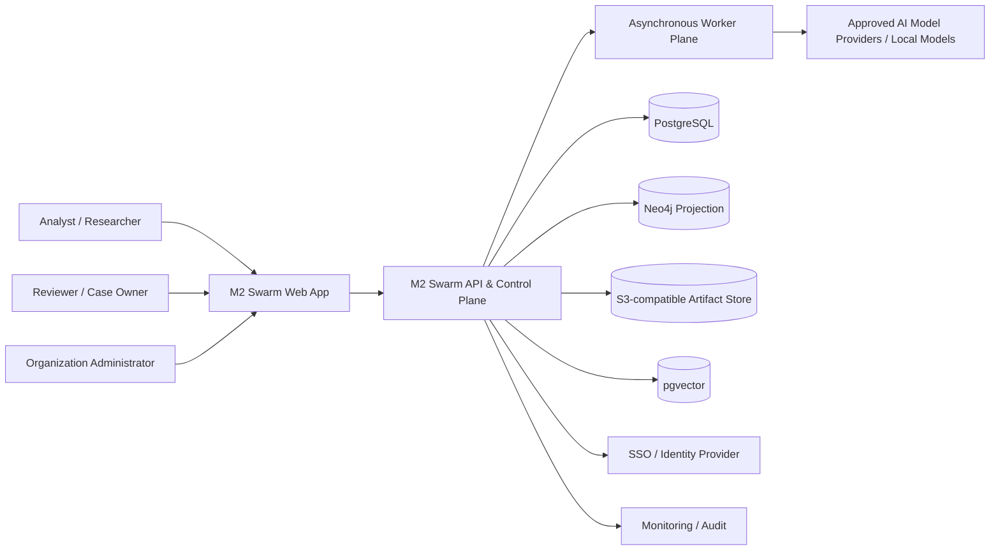

**Trust boundary:** Browser and external models are untrusted. Source documents and model output are also untrusted inputs. The backend owns authorization, policy, canonical records, graph version control, API contracts and report release.

### 2.1 Container view

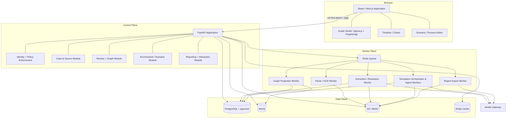

**Important ownership rule:** PostgreSQL is the source of truth for reviewed entities, claims, edges and version manifests. Neo4j is a regenerable read projection of an approved or draft graph version; ingestion must not silently bypass PostgreSQL to update authoritative graph state. Object storage holds large payloads, not the only copy of workflow state.

---

## 3. Modules, boundaries and responsibilities

| Module | Responsibilities | Input | Output / persisted state |
|---|---|---|---|
| Identity & Authorization | SSO, RBAC, tenant/case grants, classification | Identity claims and grants | Session / scoped principal / audit |
| Case Management | Create case, objective, case type, lifecycle, members | Case metadata | Versioned case record |
| Document Intake | Upload, MIME/magic validation, virus scan, checksum | PDF/MD/TXT | Original object and source metadata |
| Parsing & Chunking | Extract text, page/offset locations, language | Trusted file handle | Chunks and parse manifest |
| Structured Extraction | Candidate claims/entities/relations/events | Chunks, extraction schema | Candidates with span references |
| Entity Resolution | Canonicalization, duplicates, conflicting assertions | Candidates | Proposed merges and reviewer decisions |
| Graph Management | Nodes, edges, schema rules, versions, snapshots | Approved candidates, edits | Immutable snapshot + graph projection |
| GraphRAG | Filtered vector + graph + text retrieval | Scoped query | Ranked evidence pack and citation anchors |
| Environment | Person/organization/country templates, assumptions | Approved graph snapshot | Environment revision |
| Persona Management | Synthetic role synthesis, human validation | Graph evidence, template | Approved versioned agent cards |
| Scenario | Time horizon, parameters, interventions, constraints | Environment snapshot | Versioned scenario |
| Simulation Runtime | Deterministic tick scheduling, model calls, memory, event log | Frozen run manifest | Event stream, checkpoints, metrics |
| Reporting | Compile report with support references and uncertainty | Run artifacts, evidence packs | Reviewable report draft + exports |
| Deep Interaction | Scoped read-only report Q&A and synthetic-agent chat | Selected report/run snapshot | Conversations and cited messages |
| Governance & Observability | Audit, quotas, monitoring, policy, retention | Domain operations | Immutable events, metrics, policy decisions |

### 3.1 Case lifecycle state machine

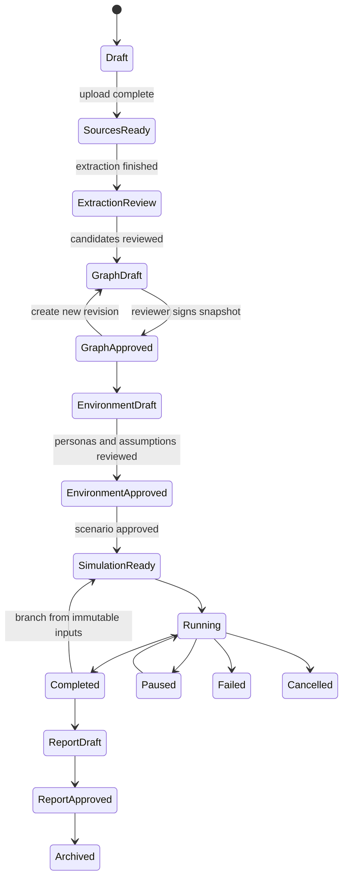

This is a **workflow projection**, not a single blocking status on the case. A case may hold multiple independently versioned graph snapshots, environments, scenarios, runs and reports. Archiving makes content read-only subject to retention policies.

---

## 4. Stage 1 — Case Creation and Graph Build

### 4.1 Case creation wizard

**Inputs:** title, description, objective/research questions, scope `PERSON | ORGANIZATION | COUNTRY`, location/language/time scope as applicable, classification, workspace members, retention policy, optional tags. The selected scope changes environment templates and graph filters; it must not hard-code all inferred entities to one type.

**Process:** validate ownership and quota → create draft case + default policies → issue scoped upload intent → transition to source intake. Every case gets a UUID and immutable initial revision. Users can save incomplete drafts.

### 4.2 Document ingestion pipeline

```mermaid
sequenceDiagram
  participant U as Browser
  participant A as API
  participant O as Object Store
  participant Q as Job Queue
  participant P as Parser Worker
  participant X as Extractor Worker
  participant D as PostgreSQL
  U->>A: POST /cases/{id}/sources/initiate
  A->>D: Authorize + reserve upload
  A-->>U: Short-lived signed upload URL
  U->>O: PUT original bytes
  U->>A: POST /sources/{id}/complete
  A->>O: Validate object size/checksum
  A->>D: Set status=QUARANTINED
  A->>Q: Enqueue scan and parse
  Q->>P: Worker consumes job
  P->>O: Fetch object; scan; parse; normalize
  P->>D: Store chunks, offsets, parse manifest
  P->>Q: Trigger extraction
  Q->>X: Extract candidate entities/claims/edges
  X->>D: Write candidates + provenance
  A-->>U: SSE status and review-ready state
```

**Job stages:** `UPLOADED → QUARANTINED → SCANNED → PARSED → CHUNKED → EXTRACTED → REVIEW_PENDING → ACCEPTED/REJECTED`, with `FAILED` and `PARTIAL` branches. Retry a step without re-uploading or duplicating accepted candidates. Files with unsupported MIME, excessive size, encrypted PDF without a valid password, malicious payload, or unacceptable parse quality are rejected or routed to manual review.

**Extraction processing:** detect language; preserve original UTF-8 text and page markers; normalize Unicode only for search; split text by semantic section with sliding context; create `(source_id, page, start_offset, end_offset, content_hash)` references; run deterministic patterns plus structured LLM extraction; Pydantic-validate typed outputs; flag unmatched evidence spans. Chunk offsets reference the **immutable parse version**, not future mutable text.

**Optional scanned PDF:** PyMuPDF detection → OCR queue (PaddleOCR/Tesseract) → store per-page OCR confidence and bounding boxes → analyst verification. OCR text must never be silently treated as verified primary text.

### 4.3 Canonical graph schema

**Node types:** Person, Organization, Country, Place, Event, Topic, Document, Claim, Institution, Group and optionally custom schema-approved types. **Edges:** MEMBER_OF, WORKS_FOR, LOCATED_IN, PART_OF, MENTIONS, RELATED_TO, PARTICIPATED_IN, OCCURRED_AT, SUPPORTS, CONTRADICTS, PRECEDES. Display `UNKNOWN_RELATION` only in review, not approved graph, unless the reviewer explicitly resolves it.

**Common node fields:** `id`, `case_id`, `tenant_id`, `type`, `display_name`, `aliases[]`, `properties`, `confidence_label`, `evidence_refs[]`, `review_status`, `valid_from`, `valid_to`, `created_at`, `revision`.  
**Common edge fields:** `id`, `case_id`, `source_node_id`, `target_node_id`, `relation_type`, `directed`, `properties`, `support_refs[]`, `contradiction_refs[]`, `valid_from`, `valid_to`, `review_status`, `revision`.

Confidence is not equivalent to probability; differentiate `EXTRACTED_UNREVIEWED`, `ANALYST_CONFIRMED`, `ANALYST_ENTERED`, `MODEL_INFERRED`, `DISPUTED`. Contradictions are first-class linked claims, not overwritten values.

### 4.4 Graph build orchestration

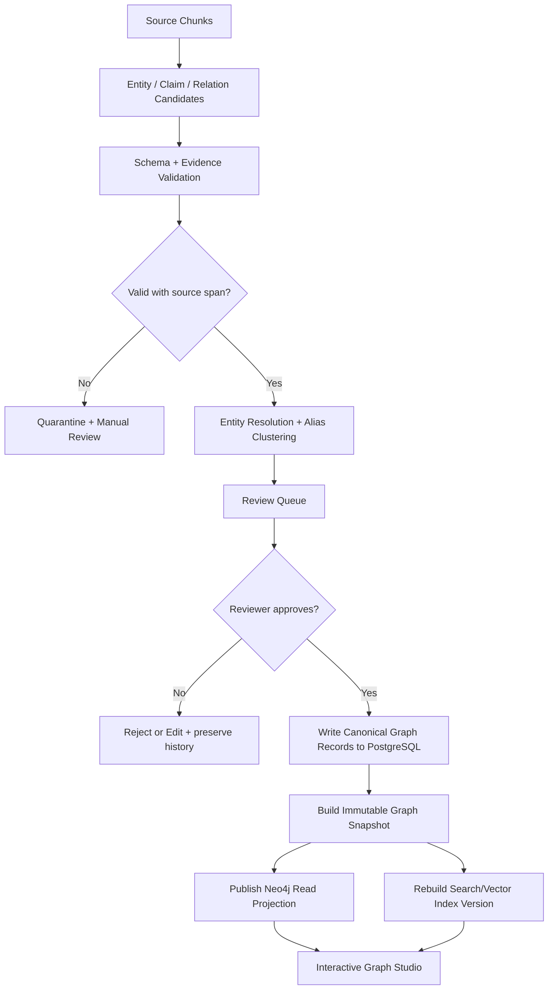

**Data integrity:** edits use optimistic locking; merge operations create redirect records so previous citations remain resolvable; delete is soft-delete plus audit; graph snapshots include content hash, schema version, extraction versions, reviewer and publication timestamp. Neo4j sync is driven by an outbox event; failed projections can replay without duplicate edges.

### 4.5 Graph UI architecture

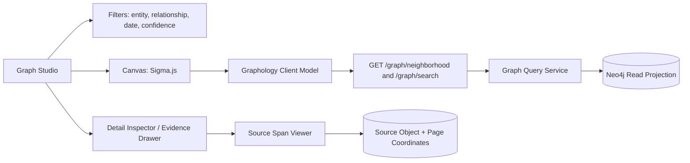

- **Sigma.js + Graphology:** recommended for high-density exploration, GPU rendering, expand-neighbors, node sizing, clusters, highlighting and drag interactions.
- **Cytoscape.js:** candidate for a separate manual graph editor when rich manipulation/layout features are required. Do not run two graph engines on the same canvas.
- **React Flow:** case-processing and scenario process flows; not the main network graph.
- **ELK.js / dagre:** structured layout for workflows and hierarchy; force-directed layout (Graphology/ForceAtlas2) for exploratory networks; large layout execution in Web Workers.
- **ECharts:** time-series event plots, edge-type distributions, run comparisons; optional vis-timeline for event inspection.

**Backend graph queries:** `/graph/neighborhood?nodeId=&depth=1&limit=250&cursor=`; `/graph/path?from=&to=&maxHops=4`; `/graph/search`; `/graph/snapshots/{id}/diff`. Server caps expansion depth and response size. Render a 2k-node interactive target initially, benchmark 10k+ under realistic graph density. Large graph browsing uses pagination, clustering and viewport-aware level of detail, not unrestricted `MATCH (n) RETURN n`.

### 4.6 GraphRAG retrieval sequence

1. Authorize tenant, case, graph snapshot and query scope.
2. Search `pgvector` chunks using embedding similarity + optional PostgreSQL full-text rank; filter case and classification **before returning candidates**.
3. Resolve matching entity mentions; traverse approved graph neighborhood in Neo4j with case/snapshot filters.
4. Join approved claim/evidence spans in PostgreSQL; rerank by relevance and provenance reliability.
5. Build a bounded **evidence pack** with source/page/span IDs, claim statuses, contradictions and missing evidence indicators.
6. Generate a response from the evidence pack only; validate structured citation IDs against retrieved evidence; return `insufficient evidence` when unsupported.
7. Log retrieval version, model version, token/cost metadata and selected citations without exposing secrets.

**Retrieval should never query other cases or include hidden tenant material.** Direct Neo4j query parameters and full-text/vector filtering are mandatory; policy validation must occur server-side rather than relying on prompt instructions.

---

## 5. Stage 2 — Environment Setup

### 5.1 Three scopes

| Scope | Default environment constructs | Required review considerations |
|---|---|---|
| **Person** | Focal role, associated organizations, surrounding stakeholders, evidence-derived topic history, bounded synthetic counterparts | Do not impersonate a real person or assert sensitive attributes; clear synthetic labels |
| **Organization** | Departments, roles, decision processes, institutional constraints, outside stakeholders | Distinguish documented structure from template assumptions |
| **Country** | Aggregated institutions, regions, social themes, economic/environmental factors, synthetic actor groups | No claim of population-level validity; sample/bias limitations documented |

A **scope** changes configuration templates, default graph filters, allowed persona archetypes, metrics and simulation assumptions; it never directly grants additional access to real personal information.

### 5.2 Environment creation pipeline

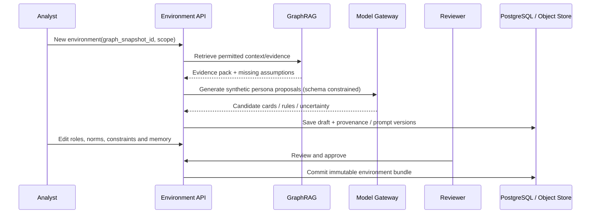

### 5.3 Synthetic persona configuration

```json
{
  "agent_id": "agt_example_001",
  "agent_kind": "synthetic_role",
  "display_name": "Regional logistics coordinator (synthetic)",
  "scope": "ORGANIZATION",
  "role": "operations coordinator",
  "goals": ["Maintain predictable service delivery"],
  "knowledge_refs": ["claim_001", "chunk_008"],
  "assumptions": ["Works under capacity constraints"],
  "decision_rules": {"response_style": "cautious", "risk_tolerance": "moderate"},
  "memory_policy": {"max_recent_events": 25, "summary_interval_ticks": 10},
  "model_profile_id": "balanced_local_or_approved_provider",
  "review_status": "PENDING"
}
```

**Memory layers:** `persona_static` (fixed rules) + `evidence_context` (approved evidence references) + `episodic` (run events) + `summary` (periodically versioned model summary). Memory writes remain **run-scoped**; simulated beliefs are not added to the verified case graph. Avoid importing sensitive personal profiles into synthetic memory.

### 5.4 Environment bundle contract

Approved bundle contains `environment_id`, `revision`, `graph_snapshot_hash`, `agent_card_hashes`, `world_rules_version`, `template_version`, `assumptions`, `safety_policy_version`, `model_profiles`, `reviewer_id`, `approval_timestamp`, `manifest_hash`. Any change creates a new revision; runs continue referencing the frozen prior revision.

---

## 6. Stage 3 — Multi-Agent Simulation

### 6.1 Runtime design

Use a **discrete-time, event-sourced scheduler**. Each simulation has a bounded number of ticks; each tick selects eligible agents, constructs per-agent observations, requests structured proposed actions, validates policy and available resources, then commits events and updates state. The engine, **not the LLM**, owns time advancement, event ordering, state transitions and budgets.

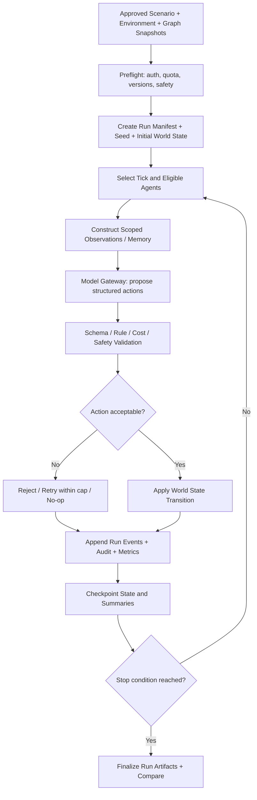

### 6.2 Dual synthetic channels

Define two **internal** virtual communication spaces, for example `PUBLIC_DISCUSSION` and `INSTITUTIONAL_EXCHANGE`. Channel names and access rules are configurable per scenario. The platform **does not** create or operate actual social accounts. Each event records `run_id`, `tick`, `channel`, `actor_agent_id`, `action_type`, `payload_ref`, `parent_event_id`, `state_delta`, `validation_status`, `model_version` and `created_at`.

### 6.3 Orchestration and reliability

- One run orchestrator owns a durable run lease; worker claims are transactional to prevent double-commit.
- Model requests use an **idempotent request key** formed from run/tick/agent/step; retries do not append duplicate events.
- Use `RUN_QUEUED`, `RUNNING`, `PAUSE_REQUESTED`, `PAUSED`, `COMPLETED`, `FAILED`, `CANCEL_REQUESTED`, `CANCELLED` states; only permitted transitions.
- Checkpoint every configurable N ticks, and on pause/cancel. Resume from latest committed checkpoint plus event replay.
- Branching creates a **new** run with parent-run reference and changed assumptions; original remains immutable.
- Each run enforces maximum agents, ticks, tokens, spend, wall-clock deadline and concurrent calls; fail safely on budget exhaustion.
- Record input graph/environment/scenario hashes, model provider and model ID, prompt version, software image digest, random seed, model sampling parameters and external dependency versions.
- **Reproducibility limit:** model-provider outputs may vary even with a seed. Guarantee traceable replay of *recorded events*, not identical regenerated LLM output.

### 6.4 Simulation event structure

```json
{
  "event_id": "evt_01",
  "run_id": "run_01",
  "tick": 17,
  "channel": "PUBLIC_DISCUSSION",
  "actor_agent_id": "agt_example_001",
  "event_type": "STATEMENT",
  "parent_event_id": null,
  "body": "This is a fictional simulation statement.",
  "basis": "SIMULATED",
  "evidence_refs": [],
  "action_validation": "ACCEPTED",
  "state_delta_ref": "s3://artifacts/runs/run_01/deltas/17.json"
}
```

### 6.5 State, metrics and outputs

State includes agent goals, beliefs and resources (all **synthetic**), world variables, channel participation and event causality. Configurable metrics can include activity count, topic prevalence, synthetic disagreement, convergence, temporal event distribution, per-agent participation and differences across scenarios. Report metric definitions and denominators. Do not label subjective narrative measures as empirical prediction accuracy.

### 6.6 Simulation sequence diagram

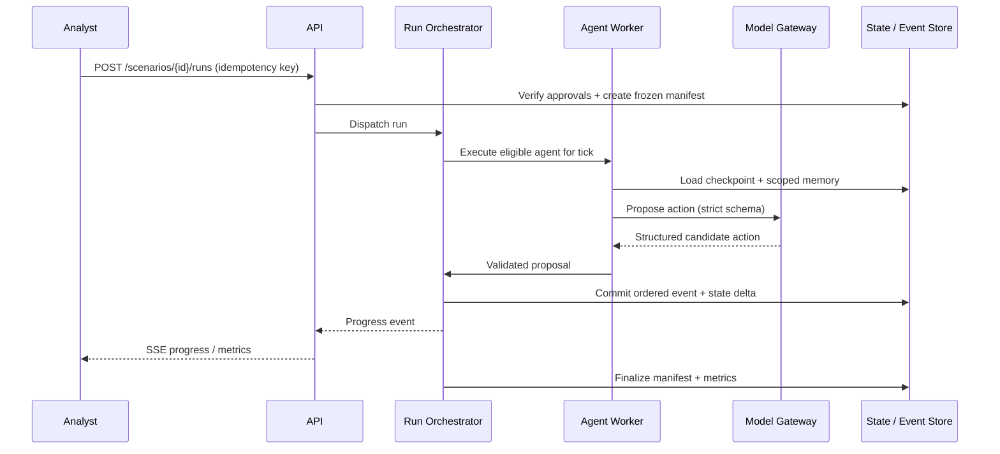

---

## 7. Stage 4 — Report Generation

**Inputs:** approved graph snapshot, selected run IDs, versioned events, metric definitions, evidence pack and analyst-selected questions. **Outputs:** report draft, claim audit, review decision, published immutable report and exports.

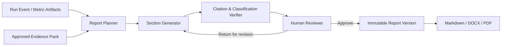

**Required claim classes:** `SOURCE_SUPPORTED`, `ANALYST_ASSUMPTION`, `MODEL_INFERENCE`, `SIMULATION_RESULT`, `UNSUPPORTED`. Each substantive assertion has `claim_class`, `support_refs`, `run_refs` as applicable, and uncertainty text. Before approval, validate that cited objects exist, are visible in the case/snapshot, and support the claimed class. Uncited or mismatched claims are flagged. No report should refer to simulated events as having occurred in reality.

**Export rendering:** Markdown canonical source → DOCX and PDF renderers with predefined styles, page numbering, figure/table captions, and embedded charts. Store each export plus a checksum and report version. Generate exports in a sandboxed, resource-limited worker.

---

## 8. Stage 5 — Deep Interaction

Two distinct modes, each visibly labeled:

1. **ReportAgent (evidence-grounded Q&A):** read-only tools over authorized report, citations, graph snapshot, run metrics and event summaries. It can explain comparisons and gaps, and must identify simulations as simulations.
2. **Synthetic-agent conversation:** roleplay with a **simulated** agent loaded from one immutable run/environment version; new conversation events do not mutate the source run unless the analyst explicitly creates a new scenario branch.

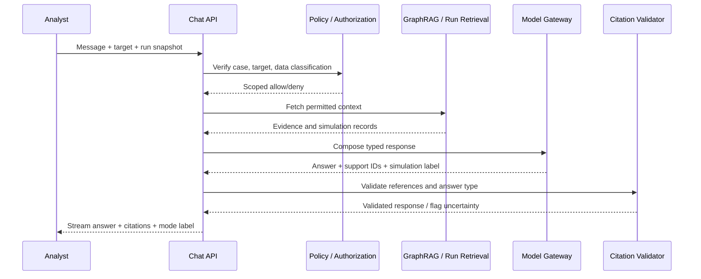

**Guardrails:** reject instructions to disclose cross-case records, manipulate simulated personas into claiming real identity, invoke unapproved tools or execute prompt-injected directions embedded in uploaded documents. User input and retrieved text cannot change system policy. Provide rate limits, safe transcript retention, redaction and a visible conversation reset.

---

## 9. Canonical data architecture

### 9.1 Storage responsibilities

| Store | Canonical data | Backup/retention considerations |
|---|---|---|
| PostgreSQL | Tenants, roles, cases, sources, parse manifests, canonical entities/edges, claims, approvals, environments, runs, reports, audit metadata | PITR, periodic encrypted backup, relational integrity |
| Neo4j | Query-optimized graph projection per case/snapshot | Rebuildable from authoritative PostgreSQL snapshots; projection watermark |
| PostgreSQL + pgvector | Chunk vectors and references; hybrid retrieval indexes | Re-embed on model/version change; access filtering |
| S3/MinIO | Original files, parsed text blobs, immutable bundles, checkpoints, exports, large event payloads | Versioning, encryption, lifecycle, integrity hashes |
| Redis | Short-lived sessions/cache, queues, leases, progress fan-out | Not sole authoritative storage for run events |
| Observability store | Metrics, redacted logs, traces | Separate retention, access control, no sensitive raw prompts by default |

### 9.2 Logical ER diagram

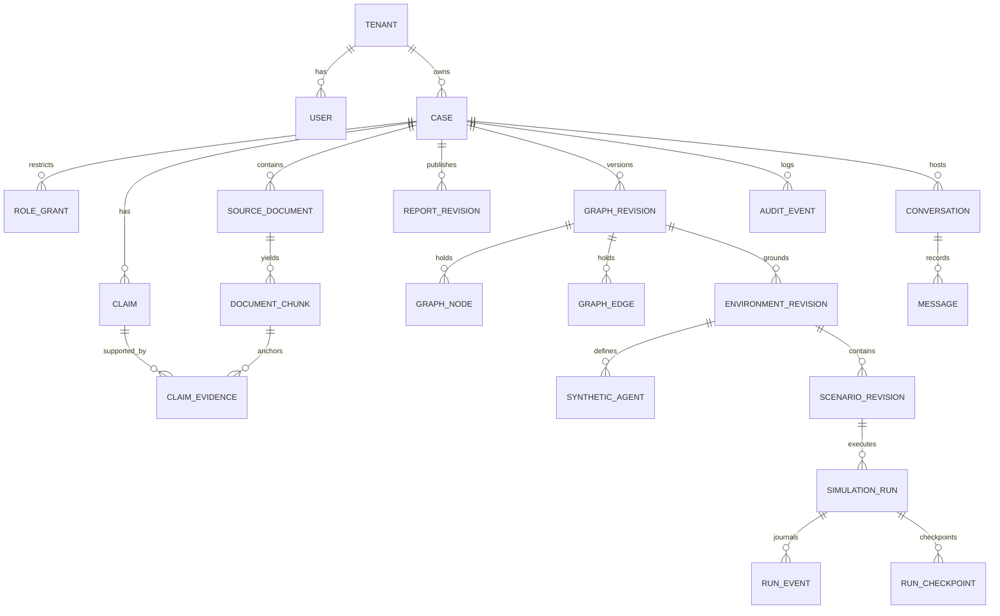

### 9.3 Identifiers and versioning

- Use UUIDv7 (or UUIDv4 consistently if runtime support is a constraint) for all externally visible IDs.
- `tenant_id`, `case_id` and immutable `revision_id` must be present in child domain records.
- Use `created_at`, `updated_at`, `created_by`, `revision`, `classification`, `deleted_at` where applicable.
- `graph_revision`, `environment_revision`, `scenario_revision`, `run_manifest` and `report_revision` become immutable after approval/finalization.
- Publish snapshots with SHA-256 hashes over canonical serialized content; use a well-defined canonicalization method and stable sorting.
- Store large payloads in object storage and keep object URI + checksum + schema version + visibility policy in PostgreSQL.

### 9.4 Consistency model

PostgreSQL commits canonical changes with an **outbox row in the same transaction**. A projection consumer updates Neo4j and vector/search projections idempotently, then advances a watermark. UI indicates `indexing` until all required projections reach the requested snapshot version. Never show a graph version as fully searchable before projected consistency is confirmed. Background failures must not corrupt the canonical graph.

---

## 10. API architecture

**Base path:** `/api/v1`. All nonpublic operations require TLS, authenticated principal and scoped authorization. REST is the primary command/query interface; SSE `text/event-stream` provides progress; optional WS for real-time collaborative graph editing later.

| Method | Endpoint | Purpose |
|---|---|---|
| POST | `/cases` | Create case |
| GET / PATCH | `/cases/{caseId}` | Get/edit case with revision check |
| POST | `/cases/{caseId}/sources/initiate` | Return short-lived signed upload URL |
| POST | `/sources/{sourceId}/complete` | Confirm upload, scan/process |
| GET | `/cases/{caseId}/sources` | Paginated list and processing status |
| GET | `/cases/{caseId}/extraction-candidates` | Candidate review queue |
| POST | `/extraction-candidates/{candidateId}/decision` | Approve/edit/reject with reason |
| GET | `/cases/{caseId}/graph/neighborhood` | Paginated graph expansion |
| GET | `/cases/{caseId}/graph/search` | Search by name/type/date |
| POST | `/cases/{caseId}/graph/revisions` | Create draft revision |
| POST | `/graph/revisions/{id}/approve` | Freeze approved graph snapshot |
| POST | `/cases/{caseId}/environments` | Draft environment by scope |
| POST | `/environments/{id}/agents/generate` | Generate synthetic persona candidates |
| POST | `/environments/{id}/approve` | Freeze environment bundle |
| POST | `/environments/{id}/scenarios` | Define scenario revision |
| POST | `/scenarios/{id}/runs` | Queue bounded simulation |
| POST | `/runs/{id}/control` | Pause/resume/cancel with state guard |
| GET | `/runs/{id}/events` | Cursor-paginated event journal |
| GET | `/runs/{id}/stream` | SSE status/events |
| POST | `/runs/{id}/branches` | Branch with modified assumptions |
| POST | `/cases/{caseId}/reports` | Create report draft |
| POST | `/reports/{id}/approve` | Human release approval |
| POST | `/reports/{id}/exports` | Queue MD/DOCX/PDF export |
| POST | `/conversations` | Select ReportAgent or synthetic-agent mode |
| POST | `/conversations/{id}/messages` | Send scoped message |
| GET | `/cases/{caseId}/audit` | Authorized audit listing |

### 10.1 Common response pattern

```json
{
  "data": {"id": "case_example", "status": "DRAFT", "revision": 3},
  "meta": {"request_id": "req_example", "trace_id": "trace_example"},
  "error": null
}
```

**Error shape:** stable `{code, message, details, retryable}` with safe user-facing errors, no stack traces. Suggested errors: `UNAUTHORIZED`, `CASE_ACCESS_DENIED`, `REVISION_CONFLICT`, `VALIDATION_FAILED`, `QUOTA_EXCEEDED`, `MODEL_PROVIDER_UNAVAILABLE`, `APPROVAL_REQUIRED`, `PROJECTION_NOT_READY`, `RUN_NOT_CONTROLLABLE`. Async creation returns `202 Accepted`, `job_id`, status URL; non-idempotent POST actions require `Idempotency-Key`; clients use `If-Match`/revision or equivalent for updates. List endpoints implement cursor pagination. API schemas generate TypeScript types to keep frontend contracts synchronized.

---

## 11. Security, privacy and trust architecture

### 11.1 Threat model and mitigations

| Threat | Control |
|---|---|
| Cross-tenant/other-case data exposure | Enforce tenant/case scope in services and storage queries; row-level security where practical; negative cross-case tests |
| Uploaded document malware | Allowlist file types, magic-byte inspection, virus scanning, PDF sandboxing, execution disabled |
| Prompt injection in documents | Treat source text as data, non-executable tool policies, typed outputs, approved tool registry, validation |
| Hallucinated source references | Strict evidence pack, citation-ID allowlist, human reviewer, unsupported-claim flags |
| Model provider leakage | Per-provider data classification policy, optional local inference, secrets manager, minimum data sent |
| Sensitive personal data | Minimize and redact, prohibit covert sensitive inference, enforce access and retention, privacy review |
| Excessive AI cost or runaway agents | Per-run and tenant budgets, maximum ticks/agents/concurrency, admission controller, circuit breaker |
| Unauthorized graph edits | RBAC, review approvals, immutable versions, audit, revision lock |
| Compromised object URL | Narrow scoped short TTL, checksum validation, private bucket, no public read ACL |
| Data deletion/retention drift | Documented lifecycle policies, legal hold mechanism, reproducible deletion/export workflows |

### 11.2 Identity and roles

Support OIDC/OAuth2 with enterprise identity provider; short-lived access tokens and server-side refresh/session protection. Roles: Super Admin, Organization Admin, Case Owner, Analyst, Reviewer, Viewer, Service Account. The service must check resource policy on *every* mutation and query, including object downloads, graph neighbors, chat tool calls and SSE event subscriptions. Approval requires eligible reviewer other than the author when separation of duties is enabled.

### 11.3 Secrets and encryption

Use HTTPS/TLS at ingress; encrypted database disks and object buckets; cloud KMS or Vault for secrets; rotate model API keys; never embed credentials in browser bundles, logs or prompt templates. Audit all sensitive exports and elevated access. Backups use distinct access policies and periodic restore drills.

### 11.4 Simulation governance

Simulation is clearly identified as exploratory. Do not present personality predictions as factual assessments of real individuals; do not emulate actual accounts for influence operations or connect simulator events to live social media posting. High-impact public-policy or political scenarios should include methodological caveats, documented assumptions, review and non-targeting safeguards. Results are not evidence of what a population will actually do.

---

## 12. Frontend information architecture

| Screen | Components and user interaction |
|---|---|
| Workspace | Cases table/cards, search, last activity, permissions |
| Case Wizard | Case scope selector (Person/Organization/Country), objective, classification, members |
| Sources | Drag/drop, upload progress, parse quality, source preview, status, retries |
| Extraction Review | Candidate grid, merge/split, accept/reject, highlighted source spans |
| Graph Studio | Sigma canvas, left filter panel, right inspector, evidence drawer, snapshots and diffs |
| Environment Setup | Scope-specific guided forms, persona cards, assumption matrix, memory settings |
| Scenario Designer | Parameter editor, event timeline, workflow visualization, preflight checks |
| Simulation Monitor | Live status, tick view, synthetic channels, timeline, event inspector, pause/resume/cancel |
| Run Comparison | Side-by-side scenarios, metric charts, deviations, traceability |
| Reports | Report outline, claim classification, citations, reviewer controls, export |
| Deep Interaction | Mode selector, chat panel, citations, selected snapshot, synthetic disclaimers |
| Admin | Users, roles, quotas, models, retention, audit logs, system health |

**Frontend design conventions:** consistent 8-point spacing system, deliberate typography, restrained visual hierarchy, keyboard support, loading/error/empty states, color-safe graph encodings with accessible labels, responsive desktop-first layouts. Do not overload graph edges with labels by default; show labels on focus/zoom. Indicate `EXTRACTED`, `CONFIRMED`, `ASSUMED`, `SIMULATED` using both text and icons, not colors alone.

### 12.1 Graph component contracts

```ts
type GraphNodeView = {
  id: string;
  label: string;
  type: string;
  size: number;
  confidenceLabel: string;
  evidenceCount: number;
  x?: number;
  y?: number;
};

type GraphEdgeView = {
  id: string;
  source: string;
  target: string;
  relationType: string;
  evidenceCount: number;
  directed: boolean;
};

type GraphPage = {
  revisionId: string;
  nodes: GraphNodeView[];
  edges: GraphEdgeView[];
  nextCursor: string | null;
  projectionReady: boolean;
};
```

Store graph selection/filter state in URL where feasible for reproducible navigation; keep large graph data in local query/cache store rather than global UI context. Fetch source evidence lazily on node/edge inspection.

---

## 13. Deployment topology

### 13.1 Local development

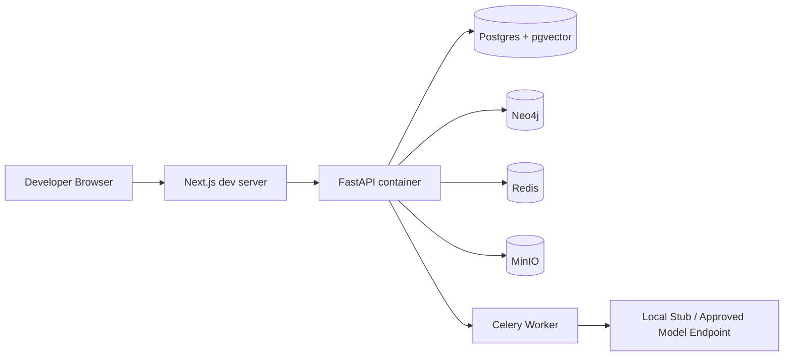

Use `docker compose` with isolated networks and volumes, seed fixtures, sample documents and fake model responses for repeatable UI/testing. Never commit real provider keys or production data. Local model gateway may return deterministic fixtures so tests do not spend tokens.

### 13.2 Recommended initial production

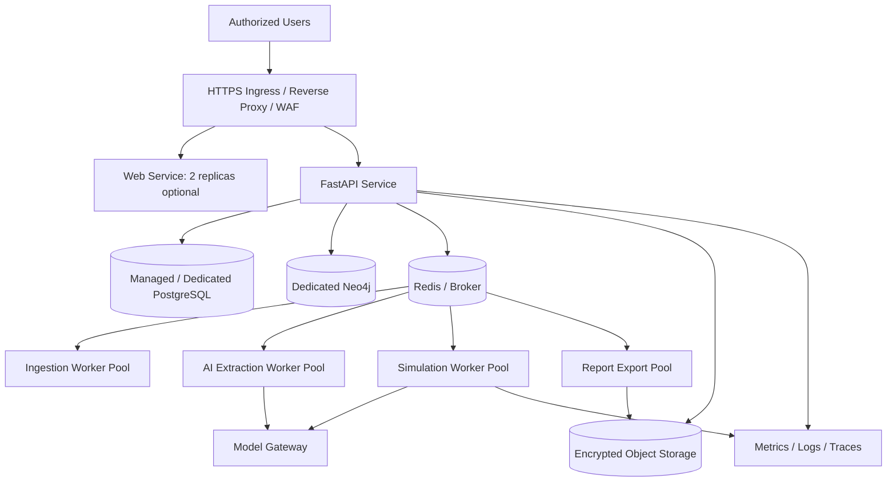

The application can be deployed on a small number of hosts for a pilot, but run the API separately from CPU/memory-heavy extraction and simulation. Keep DB and object storage access private. Scale the simulation worker pool independently once concurrency evidence justifies it.

### 13.3 Environment strategy

`dev` (synthetic fixtures) → `staging` (production-like, sanitized cases) → `production` (approval-gated). CI executes lint/typecheck, unit tests, contract tests, migration checks, security scans, and container image scanning; CD promotes immutable image digests. Schema migrations require rollback planning; feature flags gate OCR, alternate graph engines and new model providers.

---

## 14. Operational design and SLO proposals

These are **proposed targets**, not proven capabilities. Confirm after prototype and realistic-load benchmarks.

| Dimension | Initial target / mechanism |
|---|---|
| API availability | 99.5% monthly for pilot; report degradation separately |
| GET/metadata latency | p95 < 500 ms excluding asynchronous jobs (pilot load) |
| Graph neighborhood | p95 < 1.5 s for ≤250-node expansions, warm projection |
| Graph frontend | Usable interaction at ~2k visible nodes on supported workstation; benchmark 10k |
| Upload processing | Async, visible per-stage progress and actionable failures |
| Run safety | 100% runs have manifest, quota, max ticks, cancellation and final status |
| Traceability | 100% approved graph assertions retain actor/reviewer and evidence/assumption label |
| Report validation | 100% published reports pass citation/reference validation and approval |
| Backup | Daily full + continuous WAL/PITR (RPO/RTO set by business) |
| Audit | 100% security-sensitive and mutating commands emit auditable event |

**Key metrics:** `api_request_latency`, `job_queue_age`, `parsing_failure_rate`, `extraction_review_rejection_rate`, `projection_lag`, `graph_query_latency`, `model_token_cost`, `simulation_active_runs`, `run_checkpoint_age`, `citation_validation_failure_rate`, `export_failure_rate`, `audit_delivery_lag`. Alerts route to an on-call workflow; failures must expose job IDs for diagnosis.

### 14.1 Failure handling matrix

| Failure | Expected behavior |
|---|---|
| LLM timeout | Bounded retry with backoff; no duplicate event; fail/skip policy recorded |
| Parser failure | Mark source `FAILED`/`PARTIAL`, preserve original and diagnostic metadata |
| Neo4j unavailable | Canonical writes may queue; read UI marks projection unavailable; no false readiness |
| Object store unavailable | Reject or defer uploads and snapshots; never mark complete prematurely |
| Worker crash | Lease expires; resume from committed checkpoint/outbox; idempotent replay |
| User cancels run | Stop scheduling, finish/abort in-flight tick according to policy, record terminal event |
| Report citation mismatch | Block release, flag exact section and reference for reviewer |
| Authorization denied | Fail closed, generic client message, safe security audit |

---

## 15. Engineering implementation layout

**Suggested monorepo** (not a dependency on a specific tool):

```text
m2-swarm/
  apps/
    web/                         # Next.js UI
    api/                         # FastAPI composition root
  packages/
    ui/                          # Design system and reusable controls
    api-contracts/               # OpenAPI-generated TS types
    simulation-schemas/          # Versioned JSON schemas
  services/
    case/                        # Case domain
    ingestion/                   # Upload, parse, chunk
    extraction/                  # Entity/claim/edge candidates
    graph/                       # Canonical graph + read projections
    retrieval/                   # Authorized GraphRAG
    environment/                 # Scope templates and personas
    scenario/                    # Scenario versioning
    simulation/                  # Tick engine, scheduler, journal
    reporting/                   # Claim classification, exports
    interaction/                 # ReportAgent and synthetic chat
    governance/                  # Policy, audit, quota
  workers/
    ingest_worker/
    extraction_worker/
    graph_projection_worker/
    simulation_worker/
    export_worker/
  infrastructure/
    compose/
    migrations/
    deploy/
    observability/
  docs/
    adr/
    api/
    diagrams/
    threat-model/
  tests/
    unit/
    integration/
    contract/
    e2e/
    performance/
    security/
```

**Modular boundary rule:** domain modules communicate through typed interfaces and domain events; avoid direct table access from unrelated modules. Workers use versioned commands and events. Each worker can later become a standalone service without redefining domain contracts.

### 15.1 Example command/event contract

```json
{
  "event_id": "uuid",
  "event_type": "graph.snapshot.approved.v1",
  "occurred_at": "2026-10-31T14:00:00Z",
  "tenant_id": "uuid",
  "case_id": "uuid",
  "aggregate_id": "uuid",
  "aggregate_revision": 7,
  "trace_id": "trace_example",
  "payload": {
    "graph_snapshot_id": "uuid",
    "content_hash": "sha256:example",
    "projection_version": 1
  }
}
```

Messages must be schema-validated, contain no raw sensitive documents unless required, and support replay with deduplication.

---

## 16. Architecture decision records (ADRs)

| ADR | Decision | Why | Trade-off / trigger to reconsider |
|---|---|---|---|
| ADR-001 | Modular monolith + isolated workers | Lower initial operations cost, clear domain boundaries | Split when ownership/scaling or deployment cadence demands it |
| ADR-002 | PostgreSQL canonical, Neo4j projection | Consistent approval/version state plus fast traversals | Consider single-store only after query and migration benchmarks |
| ADR-003 | pgvector in PostgreSQL | Fewer components initially | Move to Qdrant if scale/search tests demand it |
| ADR-004 | Sigma.js + Graphology for exploration | Efficient large network interactions | Validate vs Cytoscape for editing UX and device support |
| ADR-005 | Event-sourced simulation journal | Replayability, provenance, audit, branching | Storage cost; compact checkpoints and archive old payloads |
| ADR-006 | Human approvals before published graph/reports | Prevent model-derived claims silently becoming facts | Admin-configurable workflows, not bypassable for high-risk classes |
| ADR-007 | Provider-neutral AI gateway | Flexible deployment and audit/cost accounting | More adapter code; test structured output per provider |
| ADR-008 | SSE for long-running progress | Simpler one-way stream than WS | Add WS only when bidirectional collaboration is needed |
| ADR-009 | Immutable approved version bundles | Honest scenario comparison and reproducibility | Requires explicit revision and storage cleanup policies |

---

## 17. Implementation roadmap and gates

| Phase | Scope | Exit criteria |
|---|---|---|
| **P0 — Foundations** | Auth/RBAC, tenant/case schema, CI/CD, Postgres, object storage, audit, job infrastructure | Access-control negative tests pass; uploads are secure; migration smoke tests pass |
| **P1 — Case & Graph Build** | Case wizard, PDF/MD/TXT intake, chunking, extraction review, graph canonical model, Neo4j projection, Sigma Studio, GraphRAG | Analyst can trace every approved edge back to document/page/span; graph snapshot is versioned |
| **P2 — Environment Setup** | Scope templates, synthetic personas, assumptions, memory bundles, approval | Three scope types produce editable immutable approved environment revision |
| **P3 — Simulation** | Scenario editor, tick engine, dual synthetic channels, logs, pause/cancel, checkpoints, comparison | Bounded run completes; pause/resume/replay and branch comparison verified |
| **P4 — Reporting** | ReportAgent drafting, claim classification, evidence validation, MD/DOCX/PDF | Unsupported claim blocks approval; exports match report revision |
| **P5 — Deep Interaction & Hardening** | Scoped report Q&A, synthetic-agent conversations, quotas, performance, security review | No cross-case leakage; simulation clearly labeled; load tests and restore drill pass |

**Suggested build sequence within P1:** canonical schema → upload security → parser/chunker with span IDs → extraction validators → reviewer UI → graph approval/outbox → Neo4j projection → graph canvas → GraphRAG retrieval → snapshot diff and acceptance tests. This sequencing prevents building an attractive graph UI before evidence integrity exists.

---

## 18. Acceptance and architecture verification checklist

- [ ] Each protected API validates tenant, case and role authorization independently of frontend controls.
- [ ] PDF/MD/TXT originals retain checksum, immutable version, page/offset references and parse quality metadata.
- [ ] Extracted claims/relationships cannot enter approved graph without recorded review decision.
- [ ] Graph projection can be rebuilt from canonical records and passes hash/count consistency verification.
- [ ] Graph queries never return another tenant/case's nodes, edges, chunks or embeddings.
- [ ] Graph Studio filters, neighborhood loading, source-span inspection and revisions work under realistic dataset sizes.
- [ ] Person, Organization and Country environments are configurable and visibly synthetic when modeled.
- [ ] Every run has immutable input hashes, model config, budget, event journal, checkpoints and terminal status.
- [ ] Pause, resume, cancel, retry and branch do not duplicate or overwrite committed run events.
- [ ] Dual-channel traffic remains inside synthetic simulation, without external platform operations.
- [ ] Published report assertions are support-validated, classified and human-reviewed.
- [ ] Deep Interaction cites accessible evidence, distinguishes simulation from real source findings, and cannot alter approved snapshots.
- [ ] Secrets, external models, logs, backups, object URLs and exports satisfy security/data-handling policies.
- [ ] Disaster-recovery restore, observability and cost budget tests pass before production approval.

---

## 19. Open architecture decisions

1. **Deployment location / constraints:** on-premises vs private cloud, storage volumes, GPU capacity, data residency requirements and allowed model vendors.
2. **Concurrency:** expected cases, average sources per case, average pages/file, average agents/run, concurrent runs and size of graph.
3. **OCR:** which languages and scanned-document quality thresholds must be supported initially.
4. **AI provider:** self-hosted local model vs approved external providers and sensitivity-based routing.
5. **Graph editor:** choose Sigma-only with custom editing vs a dedicated Cytoscape editor after UX/performance spike.
6. **Job orchestration:** Celery initially vs Temporal if weeks-long runs and complex compensation are first-release requirements.
7. **Collaboration:** single reviewer edits initially vs real-time concurrent graph editing with locks/CRDTs.
8. **Data policy:** source retention, purge/hold, classification levels and approval chain.
9. **Success metrics:** benchmark dataset, target machine specs and business-approved SLOs.
10. **Integration:** whether any future connection to other CtrlAlt products is authorized; none is assumed in this design.

---

## 20. SRS cross-reference

| Architecture area | SRS section |
|---|---|
| Cases / intake | 4.1, 4.2; UC-001 to UC-002 |
| Graph / extraction / GraphRAG | 4.3; UC-003 to UC-004 |
| Person / organization / country environments | 4.4; UC-005 to UC-008 |
| Simulations / branching | 4.5; UC-009 to UC-010 |
| Reports | 4.6; UC-011 |
| Deep interactions | 4.7; UC-012 |
| Administration and governance | 4.8; UC-013 |
| Logical model, NFRs and validation | 7–9 |

**Architecture status:** proposed technical design for engineering review. It provides specific implementation choices and interfaces, but capacity, SLOs, provider contracts, MiroFish licensing and security controls must be verified during design spikes before deployment approval.
